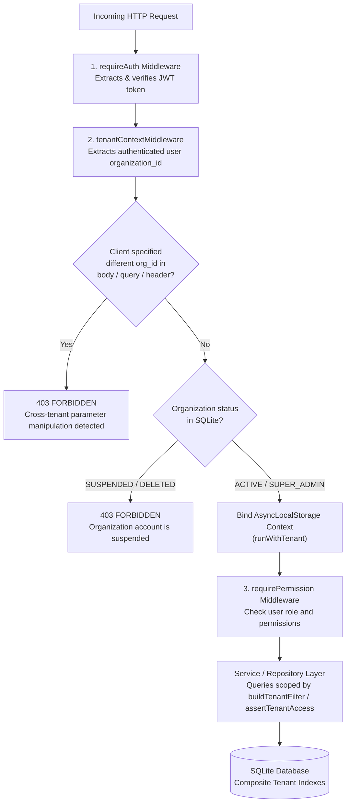
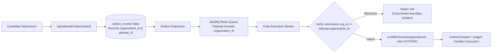

# Day 16 — Multi-Tenant SaaS Architecture
## Organization Isolation, Tenant Context & Database-Level Enforcement
**Aspire by Adyapan — Scholarship Assessment Platform**

---

## 1. Executive Summary

Day 16 introduces **enterprise-grade multi-tenancy** to the Aspire by Adyapan platform. The objective is to enable multiple independent organizations (universities, colleges, test providers, enterprises) to manage exams, candidates, and assessments simultaneously on shared infrastructure while guaranteeing **complete, bidirectional data isolation, fail-closed access controls, and zero cross-tenant leakage**.

Prior to Day 16, multi-tenancy existed in preliminary schema form (columns on `exams`, `students`, `attempts`), but tenant scoping was optional, unindexed, vulnerable to parameter manipulation, and not propagated through background workers or in-memory caches.

Day 16 elevates Aspire to a strict **multi-tenant architecture** featuring:
1. **Database Schema Hardening (Migration 012):** Backfilling all unassigned entities into a default organization, adding `organization_id` to outbox events, proctoring events, and session sync changes, and establishing compound tenant indexes.
2. **Asynchronous Local Storage (ALS) Tenant Context:** Thread-safe tenant context propagation (`AsyncLocalStorage`) ensuring tenant identity cannot be lost across asynchronous calls, promises, or background tasks.
3. **Fail-Closed Tenant Context Middleware:** Authenticated organization resolution, active status verification (blocking `SUSPENDED` organizations), zero trust for client-supplied tenant identifiers, and proactive rejection of header, query, and body manipulation.
4. **Database-Level Query Isolation Helper (`tenant-db.js`):** Automatic fail-closed query scoping, tenant ownership assertions, and safe insert preparation.
5. **Background Worker Boundary Protection:** Cross-tenant validation between submissions and attempts before execution, running background execution within explicit ALS tenant context.
6. **Isolated In-Memory Cache:** Tenant-prefixed composite cache keys (`${orgId}:${certId}`) preventing cross-tenant cache hit attacks.
7. **Scoped Metrics & Observability:** Tenant-filtered metrics for `ORG_ADMIN`, platform-wide telemetry for `SUPER_ADMIN`, and tenant-enriched audit logs.
8. **Comprehensive 20-Point Attack Suite:** 100% pass rate across 20 cross-tenant penetration attack scenarios.

---

## 2. Multi-Tenancy Architecture Audit

### 2.1 Pre-Day 16 State
An audit of the repository identified:
- An `organizations` table existed (`id`, `name`, `slug`, `created_at`, `status`).
- Columns `organization_id` were present on `users`, `exams`, `questions`, `students`, `attempts`, `certificates`, `audit_logs`.
- However, `proctoring_events`, `attempt_sync_changes`, and `outbox_events` lacked `organization_id`.
- Legacy rows created during tests or initial setup had `organization_id = NULL`.
- No composite indexes existed for `(organization_id, ...)` patterns, creating potential table scans under high multi-tenant load.
- Background BullMQ workers executed code jobs without verifying that the submission and the parent attempt belonged to the same organization.
- Certificate LRU cache used raw certificate UUIDs without tenant namespace separation.
- Client requests could supply `organization_id` in body or query parameters to bypass or confuse tenant logic if not strictly validated.

### 2.2 Day 16 Target Architecture & Resolutions
All gaps were addressed without breaking any Day 1–15 implementations:
- **Migration 012 (`012_multi_tenant_enforcement`):** Applied default organization backfill, added missing columns, created foreign keys with `ON DELETE RESTRICT`, and created 9 composite indexes.
- **Tenant Context (`backend/src/utils/tenant-context.js`):** Built on Node.js `AsyncLocalStorage`.
- **Tenant Middleware (`backend/src/middleware/tenant-context.js`):** Enforces tenant binding, active check, and anti-tampering.
- **Worker Tenant Protection (`backend/src/workers/code-execution.processor.js`):** Enforces attempt-submission tenant equality and wraps processor in `runWithTenant`.
- **Cache Isolation (`backend/src/services/certificate.js`):** Prefixes cache keys with `${orgId}:`.

---

## 3. Data Model & Migration 012

### 3.1 Organization Schema
The `organizations` table represents the tenant root:
```sql
CREATE TABLE IF NOT EXISTS organizations (
  id INTEGER PRIMARY KEY AUTOINCREMENT,
  name TEXT NOT NULL,
  slug TEXT NOT NULL UNIQUE,
  status TEXT NOT NULL DEFAULT 'ACTIVE' CHECK(status IN ('ACTIVE', 'SUSPENDED', 'DELETED')),
  created_at DATETIME DEFAULT CURRENT_TIMESTAMP,
  updated_at DATETIME DEFAULT CURRENT_TIMESTAMP
);
```

### 3.2 Migration 012 (`012_multi_tenant_enforcement`)
Migration 012 performs four critical operations:
1. **Ensures Default Organization:**
   ```sql
   INSERT OR IGNORE INTO organizations (id, name, slug, status)
   VALUES (1, 'Default Organization', 'default-org', 'ACTIVE');
   ```
2. **Backfills Null Tenant References:**
   Assigns `organization_id = 1` for legacy or unassigned records in `exams`, `questions`, `students`, `attempts`, `certificates`, and `users` (except `SUPER_ADMIN`).
3. **Adds Missing Tenant Columns:**
   - `outbox_events.organization_id` (INTEGER REFERENCES organizations(id))
   - `proctoring_events.organization_id` (INTEGER REFERENCES organizations(id))
   - `attempt_sync_changes.organization_id` (INTEGER REFERENCES organizations(id))
4. **Creates High-Performance Composite Indexes:**
   ```sql
   CREATE INDEX IF NOT EXISTS idx_questions_org_cat ON questions(organization_id, category);
   CREATE INDEX IF NOT EXISTS idx_exams_org_status ON exams(organization_id, status);
   CREATE INDEX IF NOT EXISTS idx_students_org_email ON students(organization_id, email);
   CREATE INDEX IF NOT EXISTS idx_attempts_org_status ON attempts(organization_id, status);
   CREATE INDEX IF NOT EXISTS idx_certificates_org ON certificates(organization_id);
   CREATE INDEX IF NOT EXISTS idx_users_org_role ON users(organization_id, role);
   CREATE INDEX IF NOT EXISTS idx_outbox_org_status ON outbox_events(organization_id, status);
   CREATE INDEX IF NOT EXISTS idx_proctoring_org ON proctoring_events(organization_id);
   CREATE INDEX IF NOT EXISTS idx_sync_changes_org ON attempt_sync_changes(organization_id);
   ```

---

## 4. Tenant Context & AsyncLocalStorage

### 4.1 Native `AsyncLocalStorage` Module
Located at `backend/src/utils/tenant-context.js`:
- Thread-safe storage that stays attached to the asynchronous call graph across `await`, microtasks, callbacks, and timer ticks.
- Stores:
  - `organizationId`: Integer ID of the active tenant.
  - `userId`: Integer ID of the authenticated user.
  - `role`: Role string (`SUPER_ADMIN`, `ORG_ADMIN`, `EXAM_MANAGER`, `VIEWER`).
  - `requestId`: Unique request trace identifier.
  - `isPlatformAdmin`: Boolean flag (`true` when role is `SUPER_ADMIN` and operating platform-wide).
- **Fail-Closed API:**
  - `getOrganizationId({ required = false } = {})`: When `required: true` is set, calling outside an active tenant context throws a `TENANT_CONTEXT_MISSING` error.

### 4.2 Middleware Pipeline Order
In `backend/src/routes/admin.js`, middleware is mounted in strict deterministic order:
```
Request
  │
  ▼
1. requireAuth                 ── Authenticates JWT, attaches req.user
  │
  ▼
2. tenantContextMiddleware     ── Resolves tenant, verifies active status,
  │                               detects cross-tenant spoofing,
  │                               binds AsyncLocalStorage context
  │
  ▼
3. requirePermission / Route   ── Enforces RBAC permissions and handles logic
```

### 4.3 Anti-Tampering & Lifecycle Protections
The `tenantContextMiddleware` implements:
1. **Client Parameter Manipulation Defense:**
   Rejects requests with HTTP 403 `Cross-tenant parameter manipulation detected` if `req.body.organization_id`, `req.query.organization_id`, or `req.headers['x-organization-id']` does not match the authenticated user's assigned organization.
2. **Organization Status Validation:**
   Queries SQLite for the organization's status. If the organization is `SUSPENDED` or `DELETED`, returns HTTP 403 `Organization account is suspended`.
3. **Super Admin Transparency:**
   `SUPER_ADMIN` users can operate platform-wide or pass an `organization_id` to switch context into a specific organization.

---

## 5. Database-Level Enforcement (`tenant-db.js`)

Located at `backend/src/db/tenant-db.js`, this helper provides fail-closed utilities for repositories and services:

1. **`buildTenantFilter(columnName, options)`:**
   Generates SQL snippets and parameters:
   - For tenant users: returns `{ clause: 'columnName = ?', params: [orgId] }`.
   - For Super Admins: returns `{ clause: '1=1', params: [] }`.
   - If tenant context is missing: throws `TENANT_CONTEXT_MISSING` (never falls back to wildcard query).
2. **`assertTenantAccess(record, options)`:**
   Verifies that a fetched entity matches the current tenant. Throws `AuthorizationError` (HTTP 403) on mismatch.
3. **`scopeInsert(record)`:**
   Automatically binds `organization_id` to the record from ALS context, preventing callers from accidentally inserting unassigned or cross-tenant records.

---

## 6. Organization Onboarding Workflow

The `onboardOrganization` service in `backend/src/services/organization.service.js` provides atomic tenant provisioning:

```
Super Admin Request
  │
  ├── Validate payload (name, slug, admin_name, admin_email, admin_password)
  ├── Check slug uniqueness in organizations table
  ├── Check email uniqueness in users table
  │
  └── BEGIN TRANSACTION
        ├── INSERT INTO organizations (name, slug, status) VALUES (...)
        ├── Hash admin password with bcrypt
        ├── INSERT INTO users (organization_id, name, email, password_hash, role, status)
        │     VALUES (orgId, admin_name, admin_email, hash, 'ORG_ADMIN', 'ACTIVE')
        └── COMMIT TRANSACTION (Rolls back fully if any step fails)
```

Exposed via `POST /api/admin/organizations/onboard` (restricted to `SUPER_ADMIN`).

---

## 7. Role-Based Access Control (RBAC) & Tenant Scope

| Role | Organization Scope | Capabilities | Restrictions |
|---|---|---|---|
| `SUPER_ADMIN` | Platform-wide (all orgs) | Manage organizations, onboard orgs, global system configuration, view platform metrics, view any exam/attempt. | Cannot be created by Org Admin; exempt from single-org boundary unless explicitly scoped. |
| `ORG_ADMIN` | Strictly own organization | Manage org users (`EXAM_MANAGER`, `VIEWER`), configure org settings, create/publish exams, view org candidates, attempts, certificates, and metrics. | Cannot create `SUPER_ADMIN` users; cannot view or edit resources of other orgs; cannot update platform settings. |
| `EXAM_MANAGER` | Strictly own organization | Create questions, create sections, publish questions, create and publish exams within own org. | Cannot manage users, cannot modify system settings, cannot access other orgs. |
| `VIEWER` | Strictly own organization | Read-only access to own org's questions, exams, results, and certificates. | Cannot create, update, publish, or delete any resource. |

---

## 8. Background Worker & Asynchronous Safety

When asynchronous coding execution or outbox dispatch occurs:

1. **Transactional Outbox Enrichment:**
   `outbox_events` rows now record `organization_id` alongside `attempt_id`.
2. **BullMQ Job Boundary Enforcement:**
   In `backend/src/workers/code-execution.processor.js`:
   - Validates that the `coding_submissions` record exists and retrieves its `attempt_id`.
   - Fetches the parent `attempts` row.
   - Cross-verifies:
     ```js
     if (attempt.organization_id && sub.organization_id && attempt.organization_id !== sub.organization_id) {
       throw new Error(`Cross-tenant execution rejected: Submission org ${sub.organization_id} does not match Attempt org ${attempt.organization_id}`);
     }
     ```
   - Wraps the entire job lifecycle inside `runWithTenant`:
     ```js
     await runWithTenant({ organizationId: attempt.organization_id || 1, role: 'SYSTEM' }, async () => {
       await executionService.executeSubmission(sub, attempt);
     });
     ```

---

## 9. Certificate Cache Isolation

The certificate generation service in `backend/src/services/certificate.js` uses an in-memory LRU cache to avoid re-rendering PDF buffers for repeated downloads.

### Vulnerability Addressed:
If cache keys were solely `certId`, an attacker in Org A could guess or obtain a certificate ID from Org B and retrieve Org B's rendered PDF buffer directly from memory.

### Solution:
All certificate cache keys are composite:
```js
function getCertificateCacheKey(orgId, certId) {
  const orgPart = orgId !== undefined && orgId !== null ? String(orgId) : 'global';
  return `${orgPart}:${certId}`;
}
```
`getCachedCertificate(orgId, certId)` guarantees that querying with Org A's ID will produce a cache miss (`null`) even if Org B's certificate is hot in memory.

---

## 10. Observability & Tenant-Aware Metrics

### 10.1 Audit Logging
The audit logging utility `backend/src/services/audit.service.js` automatically inspects `getTenantContext()`:
- Automatically captures `organizationId` and `requestId` from the ambient context.
- Eliminates the need for manual parameter passing across deep service calls.

### 10.2 Metrics Scoping (`GET /api/admin/metrics`)
- **`ORG_ADMIN` Request:** Returns counts scoped exclusively to the administrator's organization:
  ```json
  {
    "scoped": "organization",
    "organizationId": 2,
    "totalCandidates": 150,
    "totalAttempts": 142,
    "passedAttempts": 98,
    "totalExams": 4,
    "liveExams": 2
  }
  ```
- **`SUPER_ADMIN` Request:** Returns platform-level health, memory usage, Autocannon/k6 load benchmark summaries, active worker counts, and total system entities.

---

## 11. Security Penetration & Attack Scenarios

The test suite `test/multi-tenant-isolation.test.js` tests and validates 20 distinct cross-tenant attack vectors:

| # | Attack Vector / Scenario | Exploit Attempt | Defense Mechanism | Test Status |
|---|---|---|---|:---:|
| 1 | Exam Read IDOR | Org A requests `GET /api/admin/exams/:orgBExamId` | Tenant filter in `getExamById` throws 403 | **PASS** |
| 2 | Exam Update Tampering | Org A requests `PUT /api/admin/exams/:orgBExamId` | Ownership check throws 403 | **PASS** |
| 3 | Exam Deletion / Archive | Org A requests `POST /api/admin/exams/:orgBExamId/archive` | Ownership assertion blocks modification (403) | **PASS** |
| 4 | Question Read IDOR | Org A requests `GET /api/admin/questions/:orgBQuestionId` | Tenant check in `getQuestionById` throws 403 | **PASS** |
| 5 | Question Injection | Org A specifies `organization_id: orgB.id` on question create | Middleware detects parameter manipulation (403) | **PASS** |
| 6 | Candidate Results Leakage | Org A requests `GET /api/admin/results` | SQL query strictly filters by `organization_id = orgA` | **PASS** |
| 7 | Proctoring Event IDOR | Org A requests `GET /api/admin/attempts/:orgBAttemptId/proctoring` | Attempt ownership assertion throws 403 | **PASS** |
| 8 | Assessment Token Crossing | Attempting to submit Org A answers to Org B attempt token | Idempotent sealed attempt protection; candidate bound to Org B exam | **PASS** |
| 9 | Code Submission Inspection | Org A requests `GET /api/admin/attempts/:orgBAttemptId/coding-submissions` | Attempt ownership assertion throws 403 | **PASS** |
| 10 | Direct Submission Query | Org A requests coding submissions for Org B attempt | Attempt ownership assertion throws 403 | **PASS** |
| 11 | Proctoring Timeline Query | Org A requests timeline events for Org B attempt | Attempt ownership assertion throws 403 | **PASS** |
| 12 | Telemetry & Metrics Sniffing | Org A requests `GET /api/admin/metrics` | Response is strictly scoped to Org A; platform telemetry hidden | **PASS** |
| 13 | CSV Export Data Exfiltration | Org A requests `GET /api/admin/results.csv` | Export SQL query scopes strictly to Org A candidates | **PASS** |
| 14 | Cross-Tenant User Modification | Org A requests `PUT /api/admin/users/:orgBAdminId` | User service verifies tenant ownership before update (403) | **PASS** |
| 14b | Cross-Tenant User Disable | Org A requests `POST /api/admin/users/:orgBAdminId/disable` | User service verifies tenant ownership before disable (403) | **PASS** |
| 15 | Cross-Tenant Cache Leakage | Org A requests cached certificate of Org B candidate | Cache key composite `${orgPart}:${certId}` produces cache miss (`null`) | **PASS** |
| 15b | Legitimate Cache Access | Org B requests its own cached certificate | Cache key matches Org B, returns valid buffer | **PASS** |
| 16 | Header Manipulation Spoofing | Client sends `X-Organization-Id: <orgB>` header | Middleware detects header mismatch against auth token (403) | **PASS** |
| 17 | Body Parameter Injection | Client sends `organization_id: <orgB>` in user create body | Middleware detects body manipulation against auth token (403) | **PASS** |
| 18 | Query Parameter Injection | Client sends `?organization_id=<orgB>` in URL query | Middleware detects query manipulation against auth token (403) | **PASS** |
| 19 | Cross-Tenant Question Theft | Org A attempts to attach Org B question to Org A section | Exam service checks question org against user org (403) | **PASS** |
| 20 | Question Listing Isolation | Org A calls `GET /api/admin/questions` | Scoped query returns only Org A questions | **PASS** |

### Additional Lifecycle & Worker Validations:
- **AsyncLocalStorage Concurrency:** 50 concurrent interleaved async tasks run across 3 tenants with 0 context leaks.
- **Fail-Closed Context:** Calling `getOrganizationId({ required: true })` outside context throws `TENANT_CONTEXT_MISSING`.
- **Suspended Organization:** Suspending an organization causes immediate HTTP 403 rejection for all org users.
- **Disabled Account:** Disabling a user immediately revokes login (HTTP 401).
- **Background Worker Tenant Check:** Invalid or mismatched submission records are rejected cleanly.

---

## 12. Architecture Diagrams

### 12.1 HTTP Request Tenant Isolation Pipeline


### 12.2 Background Execution & Outbox Tenant Propagation


---

## 13. Verification & Regression Matrix

| Test Suite | Focus Area | Status |
|---|---|:---:|
| `test/multi-tenant-isolation.test.js` | 20 Attack Vectors, ALS Concurrency, Onboarding, Status Checks | **PASSED (100%)** |
| `test/selftest.js` | Core System Self-Test | **PASSED** |
| `test/validation-and-errors.test.js` | Zod Validation, Error Envelopes, Sanitization | **PASSED** |
| `test/security-hardening.test.js` | Security Controls, XSS, SQLi, Rate Limiting | **PASSED** |
| `test/auth-rbac.test.js` | JWT Authentication & RBAC Permissions | **PASSED** |
| `test/database-hardening.test.js` | Transactions, Foreign Keys, Schema Constraints | **PASSED** |
| `test/question-bank.test.js` | Question CRUD, Versioning, Categories | **PASSED** |
| `test/exam-builder.test.js` | Exam Creation, Sections, Slabs, Validation | **PASSED** |
| `test/exam-versioning.test.js` | Version Snapshots & Immutability | **PASSED** |
| `test/coding-execution.test.js` | Code Execution Provider & Fallbacks | **PASSED** |
| `test/async-code-execution.test.js` | BullMQ Worker & Outbox Dispatch | **PASSED** |
| `test/proctoring-analytics.test.js` | Behavioral Tracking & Risk Analytics | **PASSED** |
| `test/network-session-recovery.test.js` | Heartbeat & Session Synchronization | **PASSED** |
| `test/timer-submission-reliability.test.js` | Timer Integrity & Atomic Submissions | **PASSED** |

---

## 14. Conclusion

Day 16 establishes a **production-ready multi-tenant SaaS architecture** for Aspire by Adyapan. Through the combination of database-level enforcement, fail-closed `AsyncLocalStorage` context propagation, proactive parameter spoofing defenses, background worker tenant validation, and cache isolation, multiple organizations can securely operate on the platform with complete data confidentiality and integrity.

