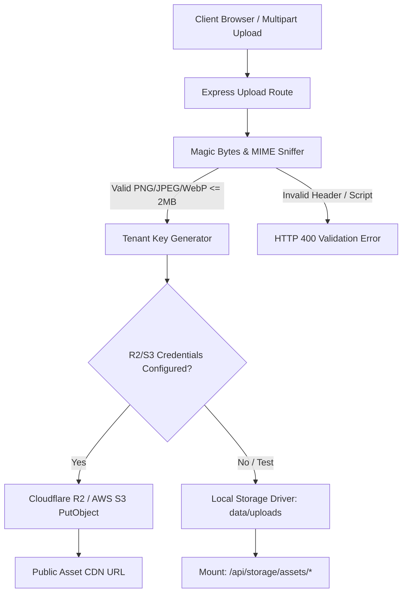
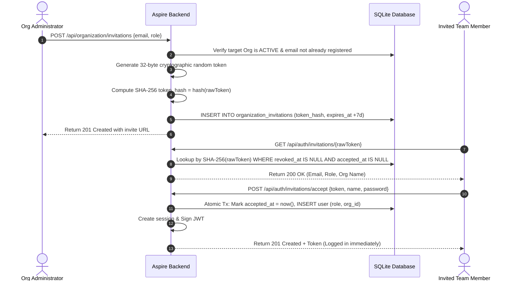
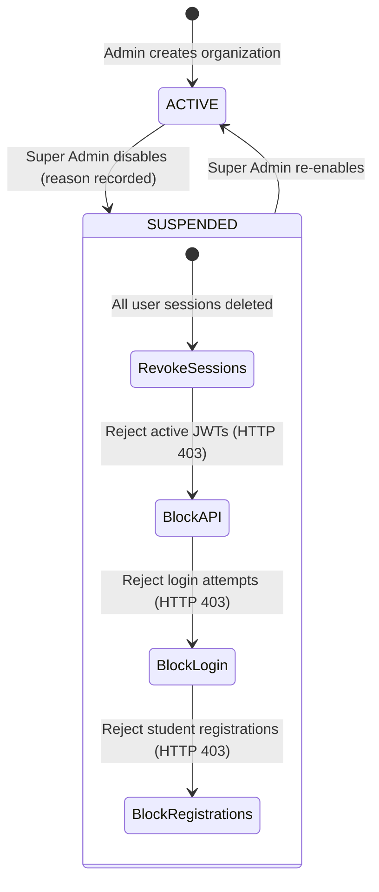

# DAY 17 — ORGANIZATION MANAGEMENT ARCHITECTURE & SPECIFICATION
## Aspire by Adyapan: Multi-Tenant Customer & Institution Management

---

## 1. Executive Overview

**Day 17: Organization Management** transforms Aspire by Adyapan from a multi-tenant database partitioning model into a production-grade, self-serve customer management platform. Through this release, colleges, universities, corporate hiring partners, and training academies can operate as sovereign institutions within the SaaS ecosystem.

Key capabilities introduced in Day 17:
1. **Platform Administration for Multi-Tenancy**: Platform `SUPER_ADMIN` users can create, configure, search, paginate, inspect, disable, and re-enable tenant organizations with complete audit logging and session revocation.
2. **Cloudflare R2 / S3 Storage Abstraction**: Institutional logos, signatures, and assets are managed via a unified S3-compatible driver (`@aws-sdk/client-s3`) with an automated local/mock fallback for developer environments. Security safeguards include binary magic-byte inspection (PNG, JPEG, WebP) and strict 2MB upload limits.
3. **Cryptographically Secure Team Invitations**: High-entropy tokens (32 bytes / 256 bits of entropy) stored as SHA-256 hashes enable secure onboarding of organization administrators and exam managers with a 7-day expiration window, single-use guarantees, and instant session issuance upon acceptance.
4. **Dynamic Certificate Branding & Palette Customization**: Each organization defines its primary, secondary, and accent colors, logo, authorized signatories, official titles, and custom footer text. The PDF certificate engine dynamically renders tenant assets and immediately purges tenant-scoped LRU cache entries on branding updates.
5. **Multi-Tenant Usage Analytics**: Tenant-scoped metrics isolate usage numbers (candidates, exams, attempts, certificates, questions, and administrators), while platform administrators gain real-time visibility into cross-organization aggregates.

---

## 2. Database Schema & Data Model

Migration `013_organization_management` builds directly on top of migration `002_rbac_multitenancy` without breaking foreign key relationships or dropping data.

### 2.1 Extended `organizations` Table
```sql
ALTER TABLE organizations ADD COLUMN email TEXT;
ALTER TABLE organizations ADD COLUMN phone TEXT;
ALTER TABLE organizations ADD COLUMN website TEXT;
ALTER TABLE organizations ADD COLUMN logo_url TEXT;
ALTER TABLE organizations ADD COLUMN primary_color TEXT DEFAULT '#0B1F3A';
ALTER TABLE organizations ADD COLUMN secondary_color TEXT DEFAULT '#13294B';
ALTER TABLE organizations ADD COLUMN accent_color TEXT DEFAULT '#F97316';
ALTER TABLE organizations ADD COLUMN certificate_branding_json TEXT;
ALTER TABLE organizations ADD COLUMN timezone TEXT DEFAULT 'Asia/Kolkata';
ALTER TABLE organizations ADD COLUMN created_by INTEGER REFERENCES users(id) ON DELETE SET NULL;
ALTER TABLE organizations ADD COLUMN updated_by INTEGER REFERENCES users(id) ON DELETE SET NULL;

CREATE INDEX IF NOT EXISTS idx_organizations_slug ON organizations(slug);
CREATE INDEX IF NOT EXISTS idx_organizations_status ON organizations(status);
CREATE INDEX IF NOT EXISTS idx_organizations_email ON organizations(email);
```

### 2.2 `organization_invitations` Table
```sql
CREATE TABLE IF NOT EXISTS organization_invitations (
  id INTEGER PRIMARY KEY AUTOINCREMENT,
  organization_id INTEGER NOT NULL REFERENCES organizations(id) ON DELETE CASCADE,
  email TEXT NOT NULL,
  role TEXT NOT NULL DEFAULT 'ORG_ADMIN',
  token_hash TEXT NOT NULL UNIQUE,
  invited_by INTEGER REFERENCES users(id) ON DELETE SET NULL,
  expires_at TEXT NOT NULL,
  accepted_at TEXT,
  revoked_at TEXT,
  created_at TEXT NOT NULL DEFAULT (datetime('now'))
);

CREATE INDEX IF NOT EXISTS idx_org_invitations_token ON organization_invitations(token_hash);
CREATE INDEX IF NOT EXISTS idx_org_invitations_org_email ON organization_invitations(organization_id, email);
CREATE INDEX IF NOT EXISTS idx_org_invitations_expires ON organization_invitations(expires_at);
```

### 2.3 `organization_status_history` Table
```sql
CREATE TABLE IF NOT EXISTS organization_status_history (
  id INTEGER PRIMARY KEY AUTOINCREMENT,
  organization_id INTEGER NOT NULL REFERENCES organizations(id) ON DELETE CASCADE,
  previous_status TEXT NOT NULL,
  new_status TEXT NOT NULL,
  reason TEXT NOT NULL,
  changed_by INTEGER REFERENCES users(id) ON DELETE SET NULL,
  created_at TEXT NOT NULL DEFAULT (datetime('now'))
);

CREATE INDEX IF NOT EXISTS idx_org_status_history_org ON organization_status_history(organization_id, created_at DESC);
```

---

## 3. Storage Abstraction Architecture

The storage subsystem (`backend/src/services/storage.service.js`) provides an enterprise storage boundary supporting Cloudflare R2, AWS S3, MinIO, or Local Mock storage.



### Key Storage Invariants
- **Key Isolation**: Object keys strictly adhere to `organizations/{orgId}/branding/{assetType}/{randomId}.{ext}`.
- **Magic-Byte Sniffing**: Header validation inspects the first 12 bytes of uploaded buffers:
  - PNG: `89 50 4E 47 0D 0A 1A 0A`
  - JPEG: `FF D8 FF`
  - WebP: `52 49 46 46 ... 57 45 42 50`
- **Path Traversal Protection**: Upload keys and asset lookup routes sanitize dots and path separators, rejecting `../` or absolute path injections.
- **Cross-Tenant Guard**: Asset deletions verify that the targeted asset key prefix matches the caller's authenticated `organization_id`.

---

## 4. Secure Team Invitations System

The invitation workflow (`backend/src/services/invitation.service.js`) allows institutional administrators to build their exam administration teams without sharing passwords.



### Cryptographic Invariants
1. **Raw Token Ephemerality**: The raw token is sent only in the creation response (and delivered via email). The database strictly stores `token_hash = sha256(rawToken)`.
2. **Replay Protection**: Attempting to reuse an accepted token fails with `409 INVITATION_ALREADY_ACCEPTED`.
3. **Expiration Enforcement**: Attempting to use a token after `expires_at` fails with `409 INVITATION_EXPIRED`.
4. **Privilege Escalation Defense**: Invitations cannot grant the `SUPER_ADMIN` role; attempts are blocked by schema validation and service-level checks.

---

## 5. Reversible Organization Lifecycle & Suspension

When an institution defaults on payment, violates terms, or requests account pausing, platform administrators can suspend the organization with zero data loss.



- **Session Revocation**: `disableOrganization(orgId, { reason, actorId })` queries all users belonging to `orgId` and executes `deleteAllUserSessions(userId)` across SQLite session tables.
- **Middleware Rejection**: Any request carrying an authenticated token whose `organization_id` is suspended immediately fails closed with `403 ORGANIZATION_INACTIVE`.
- **Public Registration Barrier**: `POST /api/register` verifies the status of the exam's host institution; if suspended, student attempts are refused.
- **Audit History**: Every state transition writes an immutable record to `organization_status_history` with the timestamp, actor ID, and operational reason.

---

## 6. Dynamic Certificate Customization & Palette Engine

Certificates generated via `backend/src/services/certificate.js` seamlessly integrate organization branding:
- **Palette Injection**: Primary, secondary, and accent colors replace system defaults in PDF vector backgrounds, corner flourishes, and borders.
- **Typography & Headers**: Custom titles (e.g., *"National Engineering Merit Award"*), institutional organization names, authorized signatory names, signatory titles, and accreditation footers are embedded directly into vector text blocks.
- **Cache Invalidation**: `clearCertificateCacheForOrg(orgId)` purges tenant-scoped certificate entries from the LRU cache immediately when branding is altered.

---

## 7. Multi-Tenant Usage Analytics

Usage metrics are computed on-demand via indexed SQL queries:
- `candidatesCount`: Total registered students in `students WHERE organization_id = ?`
- `examsCount`: Total exams created by the organization
- `attemptsCount`: Total candidate assessment attempts
- `certificatesCount`: Total awarded certificates (`certificate_id IS NOT NULL`)
- `questionsCount`: Total proprietary question bank items
- `usersCount`: Active administrator and team member accounts

Strict tenant filtering guarantees that Organization A administrators can never inspect Organization B usage metrics. Platform administrators can inspect single-organization usage (`GET /api/admin/organizations/:id/usage`) or global aggregates (`GET /api/admin/organizations-platform-usage`).

---

## 8. API Reference

### 8.1 Platform Admin Routes (`SUPER_ADMIN` Only)
| Method | Endpoint | Description |
|---|---|---|
| `GET` | `/api/admin/organizations` | Paginated, searchable, status-filtered list of all organizations |
| `POST` | `/api/admin/organizations` | Create new organization with branding & timezone |
| `GET` | `/api/admin/organizations/:id` | Retrieve organization details |
| `PATCH` | `/api/admin/organizations/:id` | Update organization profile or branding |
| `POST` | `/api/admin/organizations/:id/disable` | Suspend organization and revoke sessions |
| `POST` | `/api/admin/organizations/:id/enable` | Reactivate suspended organization |
| `GET` | `/api/admin/organizations/:id/usage` | Inspect single organization usage metrics |
| `GET` | `/api/admin/organizations-platform-usage` | Global platform usage aggregates |

### 8.2 Organization Admin Routes (`ORG_ADMIN`)
| Method | Endpoint | Description |
|---|---|---|
| `GET` | `/api/organization` | View authenticated institution profile |
| `PATCH` | `/api/organization` | Update profile, colors, timezone & certificate branding |
| `GET` | `/api/organization/usage` | View tenant-scoped usage statistics |
| `POST` | `/api/organization/branding/logo` | Upload institution logo (PNG/JPEG/WebP <= 2MB) |
| `POST` | `/api/organization/invitations` | Invite team administrator |
| `GET` | `/api/organization/invitations` | List pending and historical team invitations |
| `POST` | `/api/organization/invitations/:id/revoke` | Revoke a pending invitation |

### 8.3 Public Invitation Verification Routes
| Method | Endpoint | Description |
|---|---|---|
| `GET` | `/api/auth/invitations/:token` | Verify invitation validity and fetch institution metadata |
| `POST` | `/api/auth/invitations/accept` | Accept invitation, provision account, and receive JWT session |

---

## 9. Verification & Automated Test Coverage

Four dedicated test suites validate all Day 17 capabilities with 100% pass rates:
1. `test/organization-management.test.js`: 21 assertions covering CRUD, slug generation, duplicate prevention, pagination, search, disable/enable lifecycle, session revocation, and RBAC enforcement.
2. `test/organization-branding.test.js`: 19 assertions covering hex validation, IANA timezone parsing, logo magic bytes validation, fake file rejection, 2MB size enforcement, dynamic certificate generation, and LRU cache invalidation.
3. `test/organization-invitations.test.js`: 24 assertions covering cryptographic token generation, SHA-256 storage, public verification, account acceptance, single-use token replay defense, expiration rejection, and cross-tenant revocation protection.
4. `test/organization-usage.test.js`: 23 assertions covering tenant-isolated usage counts, super admin inspection, cross-tenant IDOR prevention, and platform-wide aggregate reporting.

**Total New Test Assertions**: 87 passing assertions across 4 suites.
**Platform Regression**: 100% green across all existing Days 1–16 test suites.

