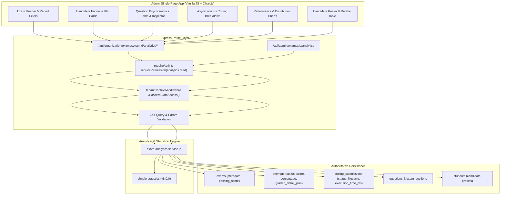

# ASPIRE BY ADYAPAN — DAY 19: EXAM ANALYTICS SPECIFICATION
## Comprehensive Exam-Level Insights, Question Psychometrics & Coding Telemetry

---

## 1. Executive Summary

Day 19 implements **Exam Analytics** for the Aspire by Adyapan multi-tenant scholarship assessment platform. While Day 18 provided organization-level SaaS macro KPIs, Day 19 provides deep, actionable analytical insights into every individual assessment.

Administrators can now inspect:
- **Candidate Funnel**: Stage-by-stage conversion and drop-off (`Registered → Started → Completed → Passed / Failed`).
- **Psychometric Question Analytics**: Item accuracy, unanswered rates, difficulty classification, and **Kelley's Item Discrimination Index ($D$)**.
- **Asynchronous Coding Telemetry**: Aggregated and per-question submission outcomes, distinguishing compilation errors, runtime failures, execution timeouts, and cloud provider infrastructure outages.
- **Performance & Statistical Distributions**: Parametric and non-parametric summary measures computed via `simple-statistics` (mean, median, standard deviation, Q1, Q3, P90, IQR), plus 20% score histograms and duration distributions.
- **Candidate Roster**: Attempt histories, retake metrics, status filters, and individual performance summaries.

---

## 2. System Architecture



---

## 3. Candidate Analytics & Funnel Definitions

### 3.1 Funnel Stages

| Stage | Definition | Database Criteria |
| :--- | :--- | :--- |
| **Registered** | Unique candidates registered for the examination. | `COUNT(DISTINCT a.student_id)` from `attempts` on `exam_id`. |
| **Started** | Candidates who actively initiated an attempt. | `COUNT(DISTINCT a.student_id)` where `a.status != 'registered'` and `a.started_at IS NOT NULL`. |
| **Completed** | Candidates who finalized and submitted an attempt. | `COUNT(DISTINCT a.student_id)` where `a.status = 'submitted'` and `a.finalization_status = 'FINALIZED'`. |
| **Passed** | Finalized candidates meeting the exam's passing criteria. | `COUNT(DISTINCT a.student_id)` where finalized and `a.percentage >= exam.passing_score`. |
| **Failed** | Finalized candidates scoring below passing threshold. | `COUNT(DISTINCT a.student_id)` where finalized and `a.percentage < exam.passing_score`. |
| **Abandoned** | Candidates who started but failed to submit within deadline. | `COUNT(DISTINCT a.student_id)` where `a.status = 'abandoned'` OR (`a.status = 'started'` AND `datetime('now') > datetime(COALESCE(deadline_at, expires_at))`). |
| **In-Progress** | Candidates currently active in their test session. | `COUNT(DISTINCT a.student_id)` where `a.status = 'started'` AND `datetime('now') <= datetime(COALESCE(deadline_at, expires_at))`. |

> [!IMPORTANT]
> Active in-progress candidates are strictly separated from abandoned candidates. An active candidate is never counted as abandoned simply due to heartbeat timing.

### 3.2 Conversion & Drop-off Formulas

$$\text{Registration-to-Start Rate} = \left(\frac{\text{Started}}{\text{Registered}}\right) \times 100$$

$$\text{Start-to-Completion Rate} = \left(\frac{\text{Completed}}{\text{Started}}\right) \times 100$$

$$\text{Pass Rate} = \left(\frac{\text{Passed}}{\text{Completed}}\right) \times 100$$

$$\text{Drop-Off Count (Registered } \to \text{ Started)} = \text{Registered} - \text{Started}$$

$$\text{Drop-Off Count (Started } \to \text{ Completed)} = \text{Started} - \text{Completed}$$

---

## 4. Question-Level Analytics & Psychometrics

### 4.1 Formulas & Rates

For every question $q$ presented across finalized attempts:

1. **Overall Accuracy**:
   $$\text{Accuracy Rate} = \left(\frac{\text{Correct Responses}}{\text{Total Eligible Attempts}}\right) \times 100$$
2. **Correct Percentage (of answered)**:
   $$\text{Correct Percentage} = \left(\frac{\text{Correct Responses}}{\text{Answered Responses}}\right) \times 100$$
3. **Wrong Percentage (of answered)**:
   $$\text{Wrong Percentage} = \left(\frac{\text{Incorrect Responses}}{\text{Answered Responses}}\right) \times 100$$
4. **Unanswered Percentage**:
   $$\text{Unanswered Percentage} = \left(\frac{\text{Unanswered Responses}}{\text{Total Eligible Attempts}}\right) \times 100$$

Unanswered questions are explicitly distinguished from wrong answers.

### 4.2 Difficulty Classification

Difficulty is classified based on overall candidate accuracy rate ($\%$):

| Tier | Accuracy Range | Classification |
| :--- | :--- | :--- |
| **Tier 1** | $\ge 85.0\%$ | `VERY_EASY` |
| **Tier 2** | $70.0\% - 84.9\%$ | `EASY` |
| **Tier 3** | $40.0\% - 69.9\%$ | `MODERATE` |
| **Tier 4** | $20.0\% - 39.9\%$ | `DIFFICULT` |
| **Tier 5** | $< 20.0\%$ | `VERY_DIFFICULT` |

### 4.3 Item Discrimination Index ($D$) — Kelley's 27% Method

The Item Discrimination Index measures how effectively a question differentiates between high-performing and low-performing candidates. Aspire implements Kelley's Upper/Lower 27% method (Kelley, 1939):

1. **Sample Eligibility**: Requires $N \ge 10$ finalized attempts. If $N < 10$, discrimination calculation is withheld (`discriminationIndex: null`, `sampleSizeInsufficient: true`) to avoid deceptive statistical noise.
2. **Grouping**: Candidates are ranked by overall exam percentage in descending order.
   - Upper Group ($U$): Top $k = \max(1, \text{round}(N \times 0.27))$ candidates.
   - Lower Group ($L$): Bottom $k = \max(1, \text{round}(N \times 0.27))$ candidates.
3. **Index Computation**:
   $$D = P_U - P_L = \left(\frac{\text{Correct in Upper Group}}{k}\right) - \left(\frac{\text{Correct in Lower Group}}{k}\right)$$
4. **Rating Guidelines**:
   - $D \ge 0.40$: `EXCELLENT` — Strong item discrimination.
   - $0.30 \le D < 0.40$: `GOOD` — Satisfactory item discrimination.
   - $0.20 \le D < 0.30$: `ACCEPTABLE` — Minor revision may improve discrimination.
   - $0.00 \le D < 0.20$: `POOR` — Poor item discrimination; does not differentiate ability.
   - $D < 0.00$: `NEGATIVE` — Critical warning. Weaker candidates answered correctly more often than stronger candidates. Flawed question text, misleading options, or incorrect answer key indicated.

### 4.4 Question Timing Instrumentation Policy

Aspire enforces strict data integrity:
- If per-question dwell timing is not recorded in attempt metadata, the service returns `averageTimeSeconds: null`, `medianTimeSeconds: null`, and `hasTimingData: false`.
- Dwell time is **never fabricated** or artificially divided across exam duration.
- When timing data is logged in question details or synchronization events (`time_spent_seconds`), arithmetic mean and median are accurately computed using `simple-statistics`.

---

## 5. Asynchronous Coding Analytics

Telemetry from asynchronous worker executions (`BullMQ` + `ioredis` + `Judge0`/Mock/OnlineCompiler) is aggregated into actionable metrics:

1. **Compilation Failures**: `submission_status = 'COMPILATION_ERROR'`.
2. **Runtime Failures**: `submission_status = 'RUNTIME_ERROR'`.
3. **Execution Timeouts**: `submission_status = 'TIME_LIMIT_EXCEEDED'`.
4. **Infrastructure/Provider Failures**: `last_error_code IN ('PROVIDER_UNAVAILABLE', 'PROVIDER_ERROR', 'NETWORK_ERROR')` or `submission_status = 'PROVIDER_ERROR'`.
5. **Successful Executions**: `submission_status = 'ACCEPTED'`.
6. **Partially Passed Submissions**: `submission_status = 'WRONG_ANSWER'` where `test_cases_passed > 0`.
7. **Pending Executions**: `lifecycle_status IN ('QUEUED', 'RUNNING')` (never classified as failure).
8. **Test Case Pass Rate**:
   $$\text{Test Case Pass Rate} = \left(\frac{\sum \text{test\_cases\_passed}}{\sum \text{test\_cases\_total}}\right) \times 100$$
9. **Language Breakdown**: Distribution of candidate language choice (`python`, `cpp`, `java`).

---

## 6. REST API Endpoints

All endpoints require `requireAuth`, `tenantContextMiddleware`, and `requirePermission(PERMISSIONS.ANALYTICS_READ)`.

### 6.1 Organization Routes (`/api/organization/exams/:examId/analytics/...`)

| Method | Endpoint | Description |
| :--- | :--- | :--- |
| `GET` | `/overview` | Candidate funnel, KPI cards, and summary stats. |
| `GET` | `/candidates` | Candidate funnel, retake metrics, and paginated candidate roster. |
| `GET` | `/questions` | Question-level psychometrics table, difficulty, and discrimination $D$. |
| `GET` | `/questions/:questionId` | Single question detail, MCQ option selection distribution or coding stats. |
| `GET` | `/coding` | Asynchronous code execution telemetry, compiler/runtime/timeout counts. |
| `GET` | `/performance` | Score histogram buckets, duration buckets, and `simple-statistics` measures. |
| `GET` | `/` | Convenience endpoint returning overview for selected exam. |

### 6.2 Admin Route (`/api/admin/exams/:id/analytics`)

Accessible by platform Super Administrators or authorized personnel. Accepts optional `?section=overview|candidates|questions|coding|performance`. By default returns combined consolidated analytics.

---

## 7. Multi-Tenant Security & IDOR Enforcement

Every analytical lookup invokes `assertExamAccess(examId, organizationId, isSuperAdmin)`:

```javascript
function assertExamAccess(examId, organizationId, isSuperAdmin = false) {
  const exam = db.prepare('SELECT ... FROM exams WHERE id = ?').get(examId);
  if (!exam) throw new NotFoundError('Exam not found');
  if (!isSuperAdmin) {
    if (!organizationId || exam.organization_id !== organizationId) {
      throw new NotFoundError('Exam not found'); // Fail-closed 404 to prevent ID enumeration
    }
  }
  return exam;
}
```

- **Fail-Closed 404**: Unauthorized attempts to access another organization's exam or question details return `404 Not Found`, preventing ID enumeration and cross-tenant leakage.
- **RBAC**: `VIEWER` role is rejected with `403 Forbidden`. `EVALUATOR`, `EXAM_MANAGER`, and `ORG_ADMIN` have `ANALYTICS_READ`.
- **Database Index Utilization**: Utilizes `idx_attempts_org_exam`, `idx_attempts_org_status_sub`, `idx_attempts_finalization`, and `idx_coding_subs_attempt`.

