# Aspire by Adyapan — Immersive Luxury Landing Page
## Day 20 Engineering & Design System Report

---

### Executive Summary

The **Aspire by Adyapan** landing page has been redesigned from a static template into an architectural, fine-art digital experience. The design adheres strictly to the primary visual reference screenshot, brand tokens, and motion inspiration from award-winning digital studios.

The page is built using **pure Vanilla JavaScript, modern HTML5, and pure CSS**, requiring zero bundlers, zero framework migrations, and zero third-party JavaScript libraries.

---

### Brand Design Tokens

```css
:root {
  --color-midnight: #08090B;
  --color-ivory: #F5F3EF;
  --color-gold: #FFC900;
  --color-gold-hover: #E5B400;
  --color-gold-deep: #B88900;

  --color-white: #FFFFFF;
  --color-dark-soft: #111216;
  --color-dark-surface: #16171D;
  --color-dark-muted: #242424;

  --color-text-primary: #08090B;
  --color-text-secondary: #66645F;
  --color-text-muted: #8E8C86;

  --color-text-light: #F5F3EF;
  --color-text-light-muted: rgba(245, 243, 239, 0.68);
  --color-text-light-subtle: rgba(245, 243, 239, 0.42);

  --color-gold-soft: rgba(255, 201, 0, 0.12);
  --color-gold-glow: rgba(255, 201, 0, 0.35);
  --color-border-light: rgba(8, 9, 11, 0.14);
  --color-border-dark: rgba(245, 243, 239, 0.16);
  --color-border-gold: rgba(255, 201, 0, 0.45);

  --font-display: "Playfair Display", Georgia, serif;
  --font-body: "Poppins", -apple-system, BlinkMacSystemFont, "Segoe UI", Arial, sans-serif;

  --ease-luxury: cubic-bezier(0.2, 0.75, 0.25, 1);
  --ease-smooth: cubic-bezier(0.22, 1, 0.36, 1);
  --ease-expressive: cubic-bezier(0.76, 0, 0.24, 1);
}
```

---

### Section Architecture & Choreography

```mermaid
flowchart TD
    subgraph S1["Section 1: Cinematic Hero (#08090B)"]
        Nav["Persistent Header (Transparent → Blur Scrolled)"]
        Headline["Editorial Playfair Typography (Ambition, Opportunity, Future)"]
        Statue["Classical Greek/Roman Marble Sculpture Bust"]
        Halo["Golden Circular Halo & Celestial Constellation"]
        Carousel["Overlapping Scholarship Highlight Card (100%, 50%, 25%, 10%)"]
    end

    subgraph S2["Section 2: The Experience (#F5F3EF)"]
        Manifesto["Warm Ivory Manifesto ('prove yourself.')"]
        Process["4-Step Horizontal Timeline (Register → Evaluate → Achieve → Celebrate)"]
        ProgressLine["Animated Connecting Progress Line"]
    end

    subgraph S3["Section 3: The Opportunity (#08090B)"]
        TierIntro["Merit Deserves to be Rewarded (Up to 100%)"]
        TierTable["Performance Tier Table (90%+, 75-89%, 60-74%, 40-59%)"]
        Counters["Animated Numbers on Intersection (0 → Target %)"]
    end

    subgraph S4["Section: Interactive Curated FAQs"]
        Accordion["Accessible Accordion (aria-expanded, zero-latency toggles)"]
    end

    subgraph S5["Section 4: Architectural Closing"]
        Colonnade["Monumental Arched Colonnade Visual & Central Dawn"]
        Silhouette["Solitary Figure Walking Forward into the Light"]
        Motto["Aspire. Achieve. Adyapan."]
    end

    subgraph S6["Section 5: Minimal Luxury Footer"]
        Footer["Brand Statement, Navigation, Portal Links & Copyright © 2026"]
    end

    S1 --> S2 --> S3 --> S4 --> S5 --> S6
```



---

### Asset Pipeline & Optimization

1. **Self-Hosted Typography**:
   - Downloaded 22 localized WOFF2 font files directly into `frontend/assets/fonts/`:
     - `Playfair Display`: 500, 600, 700, and Italic 500, 600, 700.
     - `Poppins`: 300, 400, 500, 600, 700.
   - Defined local `@font-face` rules in `frontend/assets/fonts/fonts.css`.
   - Results in zero Google Fonts network requests, immunity to external network drops, and zero layout shift.

2. **Visual Imagery**:
   - **Hero Marble Sculpture**: `frontend/assets/images/statue-hero-cutout.webp` (1200x896, transparent feathered alpha cutout) and `.png` fallback.
   - **Architectural Closing Visual**: `frontend/assets/images/architecture-closing.webp` (1376x768, high-contrast colonnade corridor with reflective floor) and `.jpg` fallback.
   - Picture tags provide modern WebP delivery with JPEG/PNG fallback.

3. **Content Security Policy (CSP)**:
   - Configured in `backend/src/security/headers.js`:
     - `fontSrc: ["'self'", "https://fonts.gstatic.com"]`
     - `styleSrc: ["'self'", "'unsafe-inline'", "https://fonts.googleapis.com"]`
     - `imgSrc: ["'self'", "data:"]`
   - Verified 100% compliant with zero CSP violations or warnings.

---

### Interaction & Motion Engineering

1. **Page-Load Choreography**:
   - `requestAnimationFrame` removes `.page-loading` and assigns `.page-loaded` to `document.body`.
   - Staggered CSS transitions animate:
     - Architectural background lines & ambient lighting (0.2s)
     - Golden circular halo expansion (0.3s)
     - Classical marble bust reveal (0.45s)
     - Eyebrow and 3 headline lines (0.2s, 0.35s, 0.5s, 0.65s)
     - Subtext and primary CTA button (0.8s, 0.95s)

2. **Fine-Pointer 3D Parallax**:
   - Enabled exclusively on desktop devices with `pointer: fine` and where `prefers-reduced-motion` is false.
   - Linear interpolation (`lerp` factor 0.08) computes smooth mouse offset coordinates without layout recalculations.
   - Displaces the sculpture figure (`translate3d(X * 14px, Y * 10px, 0)`) and moves the golden halo in counter-perspective (`-X * 8px, -Y * 6px`) to produce authentic optical depth.

3. **Scholarship Highlight Carousel**:
   - 4-slide carousel cycling through 100%, 50%, 25%, and 10% tiers.
   - Bidirectional cyclic wrapping on `<` (Prev) and `>` (Next) buttons.
   - ARIA live announcements with `aria-live="polite"` and group roles.
   - Accessible keyboard arrow (`ArrowLeft` / `ArrowRight`) navigation when focused on the card.
   - Mobile touch-swipe gesture support with 40px delta threshold.

4. **Candidate Flow Integration**:
   - All `Register Now` and `Begin Your Journey` CTAs navigate directly to `/index.html`, preserving the existing registration pipeline, validation, assessment tokens, instructions, and proctoring.

---

### Automated Verification Results

A dedicated Playwright end-to-end test suite was created in `test/landing-page.test.js` (`npm run test:landing`):

```text
====================================================
LANDING PAGE TEST SUMMARY: 49/49 PASSED (Failed: 0)
====================================================
```

- **HTTP Status & Assets**: 200/304 OK on all documents, styles, scripts, fonts, and images.
- **Console Integrity**: 0 browser console errors, 0 failed network requests.
- **Typography & Copy**: 100% match with required headlines, italics, and subtext.
- **Carousel Controls**: Passed slide switching, next/prev wrapping, and keyboard navigation.
- **Interactive Accordion**: Tested expansion/collapse states and `aria-expanded` attributes.
- **Responsive Layout Geometry**: Verified zero horizontal overflow on:
  - Large Desktop: 1440x900
  - Tablet: 768x1024
  - Mobile: 375x667
- **Mobile Drawer**: Verified hamburger visibility, drawer opening, and Escape key dismissal.
- **Full Regression**: `npm run test:regression` executed across all 33 test suites from Days 1–19 with 100% green pass rate.

