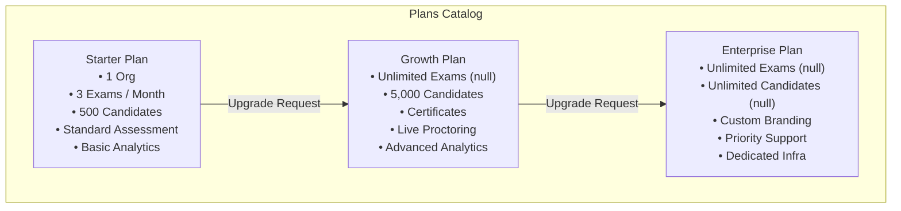
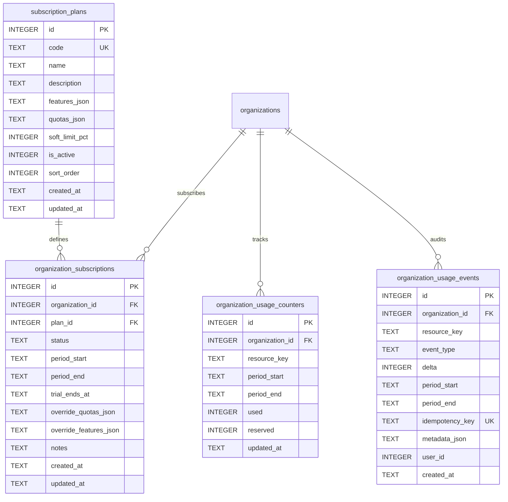

# ASPIRE BY ADYAPAN — DAY 21 ARCHITECTURE SPECIFICATION
# SUBSCRIPTION & USAGE MODEL
## SaaS Monetization Architecture — Plans, Limits, Usage Tracking, and Quota Enforcement

---

## 1. Executive Summary & Core Principles

The **Day 21 Subscription & Usage Model** establishes an enterprise-grade SaaS monetization architecture for **Aspire by Adyapan**. It provides full control over subscription plan tiers, resource quotas, feature entitlements, soft/hard usage limits, and atomic quota enforcement across multi-tenant organizations.

### Key Architectural Tenets:
1. **Decoupled from Payment Processing:** The subscription and usage engine functions purely as an authorization, metering, and gating layer. No third-party payment gateway or credit card processing is hardcoded, keeping the system portable and deployable across self-hosted and cloud environments.
2. **Database-Driven Authority:** No plan limits or feature entitlements are hardcoded into route handlers or client-side JavaScript. All limits and feature flags are defined in `subscription_plans` and dynamic per-tenant overrides on `organization_subscriptions`.
3. **Strict Invariant: Explicit Unlimited vs. Zero:** In this architecture, `null` explicitly designates an **unlimited** quota (e.g. unlimited exams on `GROWTH`, unlimited candidates on `ENTERPRISE`). `null` is never conflated with zero or treated as false. A quota value of `0` denotes strictly zero allowed units.
4. **Distinct Identity Metering:** Candidates are metered based on unique student identities (`students` table records scoped to an organization). Retakes, re-evaluations, or multiple exam attempts by an existing student do **not** consume additional candidate quota units.
5. **Publication-Only Exam Metering:** Draft exam creation, section adjustments, and question bank curation do not consume monthly exam quota. Only first-time transitions of an exam to `PUBLISHED` or `LIVE` consume 1 quota unit, enforced with transactional idempotency (`pub_exam_<examId>`). Subsequent status toggles or unpublish/republish cycles do not re-consume quota.
6. **Atomic Transactional Enforcement:** Quota checks and counter increments run inside SQLite immediate transactions with row-level locks, preventing race conditions under high concurrency.
7. **Graceful Degraded States:** Downgrades or expired subscriptions never delete or corrupt existing tenant data. Quotas simply restrict new resource consumption while preserving full read-only access and audit history.

---

## 2. Subscription Plans Catalog

Aspire ships with three standard, seeded subscription plans configured out of the box:



### Standard Plan Specifications:

| Plan Code | Display Name | Monthly Exams Quota | Candidate Quota | Feature Entitlements | Soft Limit % | Active |
|---|---|---|---|---|---|---|
| `STARTER` | Starter | 3 | 500 | `BASIC_ANALYTICS`, `STANDARD_ASSESSMENT` | 80% | `true` |
| `GROWTH` | Growth | `null` (Unlimited) | 5,000 | `BASIC_ANALYTICS`, `STANDARD_ASSESSMENT`, `ADVANCED_ANALYTICS`, `CERTIFICATES`, `PROCTORING` | 80% | `true` |
| `ENTERPRISE` | Enterprise | `null` (Unlimited) | `null` (Unlimited) | `BASIC_ANALYTICS`, `STANDARD_ASSESSMENT`, `ADVANCED_ANALYTICS`, `CERTIFICATES`, `PROCTORING`, `CUSTOM_BRANDING`, `PRIORITY_SUPPORT`, `DEDICATED_INFRASTRUCTURE`, `CUSTOM_INTEGRATIONS` | 90% | `true` |

---

## 3. Database Architecture (Migration 015)

The database schema introduces 4 core relational tables with strict foreign keys, indexes, and constraints in `backend/src/db/migrations.js`:



### Table Definitions & Key Properties:
1. **`subscription_plans`**:
   - `code`: Unique, uppercase canonical identifier (`STARTER`, `GROWTH`, `ENTERPRISE`).
   - `quotas_json`: Key-value pairs representing resource caps (`{"candidates": 500, "exams_monthly": 3}`).
   - `features_json`: Array of uppercase strings defining functional entitlements.
2. **`organization_subscriptions`**:
   - `status`: One of `TRIAL`, `ACTIVE`, `PAST_DUE`, `SUSPENDED`, `CANCELLED`, `EXPIRED`.
   - `override_quotas_json` & `override_features_json`: Allows Super Admins to customize an individual organization's allowances without creating bespoke plans.
   - Partial unique index `idx_org_subs_active_unique` ensures only **one** subscription record with an active status (`TRIAL`, `ACTIVE`, `PAST_DUE`) can exist per organization at any time.
3. **`organization_usage_counters`**:
   - Pre-aggregated period metrics for high-throughput reads.
   - Unique constraint on `(organization_id, resource_key, period_start, period_end)`.
4. **`organization_usage_events`**:
   - Immutable audit log of every quota change.
   - `idempotency_key` unique constraint guarantees zero duplicate deductions even during transient network retries or concurrent calls.

---

## 4. Quota Metering & Metering Invariants

### 4.1 Distinct Candidate Identity Metering
Candidate quota tracks unique human participants. When a candidate signs up through public registration (`/api/register`):
1. The system checks if `students` table already contains a record with the same email or phone for that organization.
2. If the student already exists (retake or re-registration), **0 quota is consumed**.
3. If the student is new, the candidate quota is checked. If available, 1 unit is consumed under the monthly period counter.

### 4.2 Monthly Published Exam Metering
Exam creation in Aspire is iterative:
1. Drafting, editing questions, updating configurations, and previewing consume **no quota**.
2. When transitioning status to `PUBLISHED` or `LIVE`:
   - If `exam.published_at` is null, the system verifies `exams_monthly` quota.
   - 1 unit is atomically consumed with idempotency key `pub_exam_${examId}`.
   - `published_at` is timestamped.
3. Moving back to `DRAFT` and republishing later detects `exam.published_at IS NOT NULL` and bypasses quota deduction.

### 4.3 Soft Limit Warnings vs. Hard Limit Blocks
- **Soft Limit (Default 80%):** Operations succeed normally, but API responses and dashboard widgets surface warnings (`quotaExceeded: false`, `isSoftLimit: true`, `percentage: 82%`).
- **Hard Limit (100%):** Operations fail immediately with HTTP `403 Forbidden`, code `QUOTA_EXCEEDED`, and structured details:
  ```json
  {
    "error": "Quota limit reached for candidates. Used: 500, Allowed: 500.",
    "code": "QUOTA_EXCEEDED",
    "details": {
      "resource": "candidates",
      "limit": 500,
      "used": 500,
      "remaining": 0,
      "percentage": 100
    }
  }
  ```

---

## 5. Middleware & Feature Gating

Located in `backend/src/middleware/quota-enforcement.js`:

### 5.1 `requireActiveSubscription`
Ensures that tenant operations are permitted only when an organization has an active or trial subscription. If suspended or cancelled:
- Rejects with HTTP `403 Forbidden` (`code: 'SUBSCRIPTION_INACTIVE'`).

### 5.2 `requireFeature(featureKey)`
Gates functional areas such as custom branding, proctoring, certificates, or advanced analytics:
- Inspects effective features (Plan features + Tenant override features).
- Super Admins (`role === 'SUPER_ADMIN'`) automatically bypass all feature gates.
- Missing entitlements yield HTTP `403 Forbidden` (`code: 'FEATURE_NOT_AVAILABLE'`).

### 5.3 `enforceQuota(resourceKey, requestedAmount)`
Declarative route middleware that checks and reserves or validates quota before executing route handlers.

---

## 6. API Reference

### 6.1 Organization Subscription Endpoints (`/api/organizations`)

| Method | Endpoint | RBAC Role | Description |
|---|---|---|---|
| `GET` | `/api/organizations/subscription` | Org Admin, Super Admin | Retrieves current active subscription, plan details, period dates, and effective overrides |
| `GET` | `/api/organizations/usage` | Org Admin, Super Admin | Retrieves full usage counters, limits, percentages, and soft/hard limit alerts |
| `GET` | `/api/organizations/usage/:resourceKey` | Org Admin, Super Admin | Retrieves usage stats and recent audit events for a specific resource |
| `GET` | `/api/organizations/plan/features` | Authenticated Member | Retrieves all active functional entitlements for the current tenant |
| `GET` | `/api/organizations/plans` | Authenticated Member | Retrieves the public catalog of available plans for upgrade comparison |

### 6.2 Super Admin Plan & Subscription Management (`/api/admin`)

| Method | Endpoint | Description |
|---|---|---|
| `GET` | `/api/admin/subscription-plans` | Lists all plans (active & inactive) |
| `POST` | `/api/admin/subscription-plans` | Creates a new subscription plan |
| `PATCH` | `/api/admin/subscription-plans/:id` | Modifies plan metadata, limits, features, or active status |
| `GET` | `/api/admin/organizations/:id/subscription` | Retrieves subscription details for any tenant |
| `POST` | `/api/admin/organizations/:id/subscription` | Assigns or upgrades/downgrades a tenant's subscription |
| `PATCH` | `/api/admin/organizations/:id/subscription` | Updates status (suspend/resume) or applies custom overrides |
| `POST` | `/api/admin/organizations/:id/usage/adjust` | Manually adjusts usage counters with audit justification |

---

## 7. Frontend User Interface

The Admin application (`frontend/admin.html` and `frontend/js/admin.js`) integrates native subscription management:

1. **Dashboard Subscription Bar (`#dashSubscriptionBar`):**
   - Renders at the top of the main dashboard overview.
   - Shows active plan pill, monthly exam meter, candidate meter, and an instant "Upgrade Plan" trigger.
2. **Dedicated Subscription & Usage Tab (`#pane-subscription`):**
   - **Current Plan Card:** Displays plan tier, billing/usage period bounds, status badge, and assigned notes.
   - **Metered Resource Quota Cards:** Visual progress bars for Candidates and Monthly Published Exams, color-coded by consumption (Green < 80%, Amber 80–99%, Red 100%).
   - **Plan Feature Grid:** Active entitlements vs. locked features with clear indicators.
   - **Plan Comparison Matrix:** Side-by-side comparison of Starter, Growth, and Enterprise plans with action buttons.
3. **Upgrade Request Modal (`#upgradeModal`):**
   - Accessible from any quota card or banner.
   - Allows administrators to select a target plan, provide estimated student volume, and submit upgrade inquiries directly to platform administrators.

---

## 8. Verification & Test Coverage

The Day 21 subscription and usage architecture is validated by 7 dedicated test suites totaling 121 automated assertions:

| Test Suite | File | Assertions | Result |
|---|---|---|---|
| Plan Catalog & Invariants | `test/subscription-plans.test.js` | 25 | **PASS** |
| Lifecycle & State Transitions | `test/subscription-lifecycle.test.js` | 23 | **PASS** |
| Usage Metering & Audit Events | `test/subscription-usage.test.js` | 18 | **PASS** |
| Quota Enforcement & Invariants | `test/subscription-quota.test.js` | 18 | **PASS** |
| Concurrency & Race Protection | `test/subscription-concurrency.test.js` | 7 | **PASS** |
| Multi-Tenant Security & Isolation | `test/subscription-security.test.js` | 12 | **PASS** |
| Feature Entitlements & Gating | `test/subscription-features.test.js` | 18 | **PASS** |
| **Total** | | **121** | **100% PASS** |

