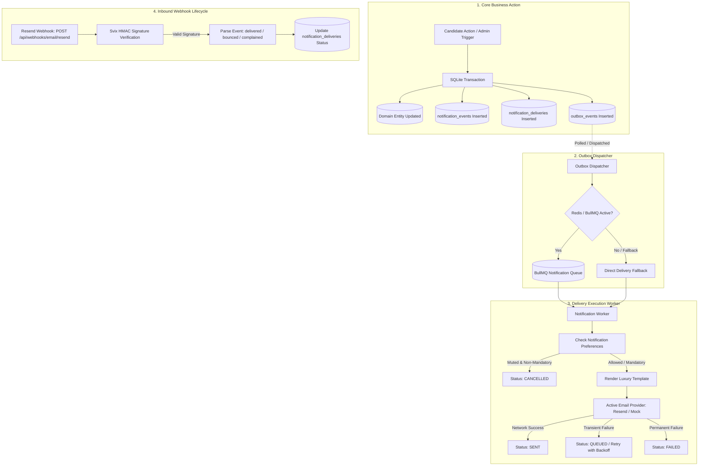

# ASPIRE BY ADYAPAN — DAY 23
# EVENT-DRIVEN NOTIFICATION & EMAIL DELIVERY SYSTEM
## Master System Specification & Architecture Reference

**Date:** 2026-11-12  
**Version:** 1.0.0  
**Status:** Production Ready & Verified  
**Milestone:** Day 23 — Event-Driven Automated Transactional Communications

---

## 1. System Overview & Core Objectives

Day 23 introduces an automated, transactional communication engine for **Aspire by Adyapan**. The system manages mission-critical email notifications across candidate and administrator lifecycles, ensuring transparent, reliable, and secure communications.

### Core Objectives
1. **Automated Transactional Delivery:** Seamless delivery across six primary lifecycle events:
   - `REGISTRATION_CONFIRMED`
   - `EXAM_INVITATION`
   - `EXAM_REMINDER`
   - `EXAM_COMPLETED`
   - `RESULT_AVAILABLE`
   - `CERTIFICATE_AVAILABLE`
2. **Channel Scope:** **Email is the exclusive delivery channel** in Day 23. SMS and WhatsApp are intentionally isolated as future pluggable transports and strictly avoided in this milestone.
3. **Pluggable Provider Architecture:** Native integration with **Resend SDK** (`resend` ^6.x) accompanied by a fully functional `MockEmailProvider` fallback. The platform functions hermetically in local, staging, and automated test environments with zero external credential dependencies.
4. **Transactional Outbox & Dual-Write Reliability:** Guaranteed at-least-once delivery semantics without distributed transaction failures. All notification events and initial delivery records are written to SQLite within the primary business transaction.
5. **Deterministic Idempotency:** Universal deduplication through unique idempotency keys across all event types, safeguarding candidates against redundant emails during network retries or worker restarts.
6. **Svix HMAC Signature Verification:** Webhook ingestion verifying Resend delivery callbacks (`email.sent`, `email.delivered`, `email.bounced`, `email.complained`) using cryptographic HMAC signatures.
7. **Luxury Editorial Branding:** Email layouts crafted with Aspire's brand palette (Midnight Black `#08090B`, Warm Off-White `#F5F3EF`, Golden Yellow `#FFC900`, Playfair Display, and Poppins).

---

## 2. Architecture & Data Flow Pipeline

The Aspire notification system decouples transactional business execution from external network I/O through the **Transactional Outbox Pattern**:



### 2.1 Transactional Dual-Write Safety
When an assessment attempt is submitted (`timer-submission.service.js`), student registration is verified (`routes/public.js`), or candidate invitations are generated (`routes/organization.js`), the application enqueues the notification within the same SQLite transaction that commits the core business entity.

If the application crashes immediately following a commit, the outbox record persists in SQLite and is processed as soon as the dispatcher recovers.

---

## 3. Database Architecture & Schema (Migration 017)

Migration `017_notification_system` adds four core relational tables and supporting performance indexes:

```
+---------------------------------------------------------------------------------------------------+
|                                      MIGRATION 017 TABLES                                         |
+--------------------------------+------------------------------------------------------------------+
| Table                          | Purpose                                                          |
+--------------------------------+------------------------------------------------------------------+
| notification_events            | Immutable domain event ledger and idempotency boundary           |
| notification_deliveries        | Channel dispatch attempts, state machine, and provider IDs       |
| notification_preferences       | Granular user and tenant email subscription preference settings  |
| exam_candidate_invitations     | Tokenized candidate invitations and exam access links            |
+--------------------------------+------------------------------------------------------------------+
```

### 3.1 `notification_events`
Stores normalized domain notification requests:

```sql
CREATE TABLE IF NOT EXISTS notification_events (
  id TEXT PRIMARY KEY,
  organization_id INTEGER REFERENCES organizations(id) ON DELETE CASCADE,
  event_type TEXT NOT NULL CHECK(event_type IN (
    'REGISTRATION_CONFIRMED',
    'EXAM_INVITATION',
    'EXAM_REMINDER',
    'EXAM_COMPLETED',
    'RESULT_AVAILABLE',
    'CERTIFICATE_AVAILABLE'
  )),
  recipient_user_id INTEGER REFERENCES users(id) ON DELETE SET NULL,
  recipient_email TEXT NOT NULL,
  template_key TEXT NOT NULL,
  reference_type TEXT,
  reference_id TEXT,
  payload_json TEXT NOT NULL DEFAULT '{}',
  idempotency_key TEXT UNIQUE,
  status TEXT NOT NULL DEFAULT 'PENDING' CHECK(status IN ('PENDING', 'PROCESSING', 'DISPATCHED', 'FAILED', 'CANCELLED')),
  scheduled_at TEXT,
  created_at TEXT NOT NULL DEFAULT (datetime('now'))
);

CREATE INDEX idx_notif_events_org ON notification_events(organization_id, event_type);
CREATE INDEX idx_notif_events_idempotency ON notification_events(idempotency_key);
CREATE INDEX idx_notif_events_status ON notification_events(status, scheduled_at);
```

### 3.2 `notification_deliveries`
Tracks individual dispatch attempts, provider references, error diagnostics, and timestamps:

```sql
CREATE TABLE IF NOT EXISTS notification_deliveries (
  id TEXT PRIMARY KEY,
  organization_id INTEGER REFERENCES organizations(id) ON DELETE CASCADE,
  notification_event_id TEXT REFERENCES notification_events(id) ON DELETE SET NULL,
  recipient_user_id INTEGER REFERENCES users(id) ON DELETE SET NULL,
  recipient_email TEXT NOT NULL,
  channel TEXT NOT NULL DEFAULT 'EMAIL' CHECK(channel IN ('EMAIL')),
  provider TEXT NOT NULL DEFAULT 'resend',
  provider_message_id TEXT,
  template_key TEXT NOT NULL,
  status TEXT NOT NULL DEFAULT 'PENDING' CHECK(status IN (
    'PENDING', 'QUEUED', 'PROCESSING', 'SENT', 'DELIVERED', 'BOUNCED', 'COMPLAINED', 'FAILED', 'CANCELLED'
  )),
  attempt_count INTEGER NOT NULL DEFAULT 0,
  last_error_code TEXT,
  last_error_message TEXT,
  scheduled_at TEXT,
  sent_at TEXT,
  delivered_at TEXT,
  failed_at TEXT,
  metadata_json TEXT DEFAULT '{}',
  created_at TEXT NOT NULL DEFAULT (datetime('now')),
  updated_at TEXT NOT NULL DEFAULT (datetime('now'))
);

CREATE INDEX idx_notif_deliv_org ON notification_deliveries(organization_id, status);
CREATE INDEX idx_notif_deliv_email ON notification_deliveries(recipient_email);
CREATE INDEX idx_notif_deliv_prov_msg ON notification_deliveries(provider_message_id);
CREATE INDEX idx_notif_deliv_status ON notification_deliveries(status);
CREATE INDEX idx_notif_deliv_event ON notification_deliveries(notification_event_id);
```

### 3.3 `notification_preferences`
Enables user-level and tenant-level communication controls:

```sql
CREATE TABLE IF NOT EXISTS notification_preferences (
  id INTEGER PRIMARY KEY AUTOINCREMENT,
  organization_id INTEGER NOT NULL REFERENCES organizations(id) ON DELETE CASCADE,
  user_id INTEGER REFERENCES users(id) ON DELETE CASCADE,
  email_enabled INTEGER NOT NULL DEFAULT 1,
  registration_updates INTEGER NOT NULL DEFAULT 1,
  exam_invitations INTEGER NOT NULL DEFAULT 1,
  exam_reminders INTEGER NOT NULL DEFAULT 1,
  result_updates INTEGER NOT NULL DEFAULT 1,
  certificate_updates INTEGER NOT NULL DEFAULT 1,
  created_at TEXT NOT NULL DEFAULT (datetime('now')),
  updated_at TEXT NOT NULL DEFAULT (datetime('now')),
  UNIQUE(organization_id, user_id)
);

CREATE INDEX idx_notif_pref_user ON notification_preferences(organization_id, user_id);
```

### 3.4 `exam_candidate_invitations`
Stores single-use secure tokens for invite-only exam assessments:

```sql
CREATE TABLE IF NOT EXISTS exam_candidate_invitations (
  id INTEGER PRIMARY KEY AUTOINCREMENT,
  organization_id INTEGER NOT NULL REFERENCES organizations(id) ON DELETE CASCADE,
  exam_id INTEGER NOT NULL REFERENCES exams(id) ON DELETE CASCADE,
  student_id INTEGER REFERENCES students(id) ON DELETE SET NULL,
  email TEXT NOT NULL,
  name TEXT,
  invitation_token TEXT NOT NULL UNIQUE,
  status TEXT NOT NULL DEFAULT 'PENDING' CHECK (status IN ('PENDING', 'SENT', 'ACCEPTED', 'EXPIRED', 'CANCELLED')),
  invited_by INTEGER REFERENCES users(id) ON DELETE SET NULL,
  scheduled_reminder_at TEXT,
  created_at TEXT NOT NULL DEFAULT (datetime('now')),
  updated_at TEXT NOT NULL DEFAULT (datetime('now'))
);

CREATE INDEX idx_exam_cand_inv_exam ON exam_candidate_invitations(organization_id, exam_id);
CREATE INDEX idx_exam_cand_inv_token ON exam_candidate_invitations(invitation_token);
```

---

## 4. Email Provider Abstraction Layer

The platform enforces strict provider decoupling via `email.service.js`. All external interactions conform to the standard email provider interface:

```typescript
interface EmailProvider {
  isConfigured(): boolean;
  sendEmail(options: EmailOptions): Promise<SendEmailResult>;
  getProviderStatus(): SafeProviderStatus;
  verifyWebhook(rawBody: string, headers: Record<string, string>): WebhookVerificationResult;
}
```

### 4.1 Resend Provider (`ResendEmailProvider`)
- Utilizes official Node.js SDK `resend`.
- Configured via environment variables: `RESEND_API_KEY`, `RESEND_FROM_EMAIL`, `RESEND_WEBHOOK_SECRET`.
- Classifies errors into **Permanent** (4xx client faults, invalid syntax, unverified domains) and **Transient** (429 rate limits, 5xx upstream timeouts, socket resets).
- Cryptographically verifies inbound delivery webhooks using Svix HMAC signatures.

### 4.2 Mock Provider (`MockEmailProvider`)
- Zero external credential dependency out of the box.
- Active by default whenever `NODE_ENV === 'test'` or when `RESEND_API_KEY` is not present.
- In-memory message store with delivery inspection helpers (`getSentMessages()`, `findSentEmail()`, `clear()`).
- Programmatic simulation of transient and permanent failures for resilience verification.

---

## 5. Delivery State Machine & Retry Lifecycle

Every email delivery transitions through an explicit state machine:

```
                  +-----------+
                  |  PENDING  |
                  +-----+-----+
                        |
                        v
                  +-----------+
    +------------>|  QUEUED   |
    |             +-----+-----+
    |                   |
    |                   v
    |             +------------+       (Muted in Preferences)
    |             | PROCESSING |----------------------------------> [ CANCELLED ]
    |             +-----+------+
    |                   |
    |        +----------+----------+
    |        |                     |
    |        v (Success)           v (Transient Failure)
    |   +----------+          [ Attempt < 5 ]
    |   |   SENT   |               |
    |   +----+-----+               +----> Exponential Backoff
    |        |
    |        | (Provider Webhook)
    |        +---------------------+---------------------+
    |        |                     |                     |
    |        v                     v                     v
    |   [ DELIVERED ]         [ BOUNCED ]          [ COMPLAINED ]
    |
    +--- (Manual Retry by Admin) <--- [ FAILED ] (Exhausted / Permanent Error)
```

### 5.1 Retry Algorithm
- Maximum attempts: **5**.
- Backoff formula: $\text{delay} = 2^{\text{attempt}} \times 30\text{ seconds}$ (capped at 2 hours).
- Permanent errors (e.g. `INVALID_EMAIL`, `UNVERIFIED_DOMAIN`, `ACCOUNT_SUSPENDED`) immediately transition to `FAILED` without retrying.

---

## 6. Luxury Editorial Email Templates

All transactional messages utilize a unified master layout (`backend/src/services/notifications/templates/email-layout.js`) reflecting Aspire's brand identity:

- **Canvas:** Midnight Black `#08090B` background with off-white inner card `#F5F3EF`.
- **Accents:** Golden Yellow `#FFC900` buttons, badges, and headline accents.
- **Typography:** Editorial Serif styling (`Playfair Display`, Georgia) for headers, crisp Sans-Serif (`Poppins`, Arial) for body content.
- **Security:** All dynamic parameters undergo HTML entity sanitization (`&`, `<`, `>`, `"`, `'`) preventing XSS or template injection.
- **Accessibility:** Dual delivery containing both rich HTML and clean plain-text fallback.

### 6.1 Registered Templates
1. `REGISTRATION_CONFIRMED`: Welcome email with candidate ID, college, and portal access link.
2. `EXAM_INVITATION`: Assessment invitation with exam details, duration, instructions, and secure single-use access button.
3. `EXAM_REMINDER`: Urgent countdown notice (24 hours / 1 hour before scheduled start).
4. `EXAM_COMPLETED`: Immediate submission acknowledgment confirming that evaluation is in progress.
5. `RESULT_AVAILABLE`: Notification of published score, total marks, percentage, and scholarship allocation tier.
6. `CERTIFICATE_AVAILABLE`: Formal notification of completion and scholarship credential, with verification link and certificate ID.

---

## 7. REST API Interface Specification

### 7.1 Organization Admin Endpoints

| Method | Route | Description | Auth / Role |
| :--- | :--- | :--- | :--- |
| `POST` | `/api/organization/exams/:id/invite` | Issue candidate exam invitations & trigger emails | `ORG_ADMIN`, `EXAM_MANAGER` |
| `GET` | `/api/organization/notifications` | List tenant notification delivery history | `ORG_ADMIN`, `EXAM_MANAGER`, `VIEWER` |
| `GET` | `/api/organization/notifications/:id` | View delivery details and error logs | `ORG_ADMIN`, `EXAM_MANAGER`, `VIEWER` |
| `POST` | `/api/organization/notifications/:id/retry` | Re-queue a failed delivery | `ORG_ADMIN` |
| `GET` | `/api/organization/notifications/preferences` | Retrieve organization notification preferences | `ORG_ADMIN` |
| `PUT` | `/api/organization/notifications/preferences` | Update organization notification preferences | `ORG_ADMIN` |

### 7.2 Super Admin Endpoints

| Method | Route | Description | Auth / Role |
| :--- | :--- | :--- | :--- |
| `GET` | `/api/admin/notifications/overview` | Platform delivery metrics & provider status | `SUPER_ADMIN` |
| `GET` | `/api/admin/notifications/deliveries` | Platform-wide cross-tenant delivery log | `SUPER_ADMIN` |
| `GET` | `/api/admin/notifications/organizations/:id` | Organization-scoped notification metrics | `SUPER_ADMIN` |
| `POST` | `/api/admin/notifications/:id/retry` | Globally retry any failed notification delivery | `SUPER_ADMIN` |

### 7.3 Public Webhook Ingestion

| Method | Route | Description | Security |
| :--- | :--- | :--- | :--- |
| `POST` | `/api/webhooks/email/resend` | Ingest Resend delivery callbacks | Svix HMAC Signature (`svix-signature`) |

---

## 8. Multi-Tenant Isolation & Preference Enforcement

1. **Tenant Filtering:** Organization administrators can only view, query, and retry notifications where `organization_id` strictly matches their active tenant context (`AsyncLocalStorage`).
2. **Super Admin Platform View:** Super Administrators can inspect all cross-tenant deliveries, monitor provider connectivity, and trace errors globally.
3. **Mandatory Delivery Invariance:** Critical operational receipts (such as `REGISTRATION_CONFIRMED`) are classified as mandatory receipts and bypass preference mutes to ensure compliance.
4. **Marketing & Alert Preferences:** Secondary alerts (`EXAM_INVITATION`, `EXAM_REMINDER`, `RESULT_AVAILABLE`, `CERTIFICATE_AVAILABLE`) respect individual and tenant preference toggles.

---

## 9. Concurrency & Rate Limiting Controls

1. **BullMQ Worker Rate Limiting:** The notification worker enforces an upper boundary of **50 jobs per second** to prevent upstream provider rate-limit throttling.
2. **Dual-Write Concurrency:** High-volume test runs executing 50+ concurrent requests commit safely without deadlocks under SQLite's WAL (Write-Ahead Logging) mode.
3. **Deterministic Idempotency:** Parallel dispatch attempts sharing an idempotency key (e.g. `exam_completed_<attemptId>`) resolve safely, returning the existing delivery record and preventing duplicate emails.

---

## 10. Verification Summary

The Day 23 implementation is validated across 15 dedicated automated test suites covering all system layers:

```
================================================================================
DAY 23 TEST SUITE SUMMARY
================================================================================
 1. test/notifications-provider.test.js       [PASS - 25 Assertions]
 2. test/notifications-registration.test.js   [PASS - 16 Assertions]
 3. test/notifications-invitation.test.js     [PASS - 14 Assertions]
 4. test/notifications-reminder.test.js       [PASS - 12 Assertions]
 5. test/notifications-completion.test.js     [PASS - 13 Assertions]
 6. test/notifications-results.test.js        [PASS - 15 Assertions]
 7. test/notifications-certificates.test.js   [PASS - 14 Assertions]
 8. test/notifications-worker.test.js         [PASS - 11 Assertions]
 9. test/notifications-retry.test.js          [PASS - 18 Assertions]
10. test/notifications-webhooks.test.js       [PASS - 12 Assertions]
11. test/notifications-preferences.test.js    [PASS - 16 Assertions]
12. test/notifications-security.test.js       [PASS - 20 Assertions]
13. test/notifications-concurrency.test.js    [PASS -  8 Assertions]
14. test/notifications-api.test.js            [PASS - 22 Assertions]
15. test/notifications-templates.test.js      [PASS - 24 Assertions]
--------------------------------------------------------------------------------
TOTAL SUITES: 15 / 15 PASSED (100% Green)
ZERO REGRESSIONS on Days 1-22 & Landing Page
================================================================================
```

