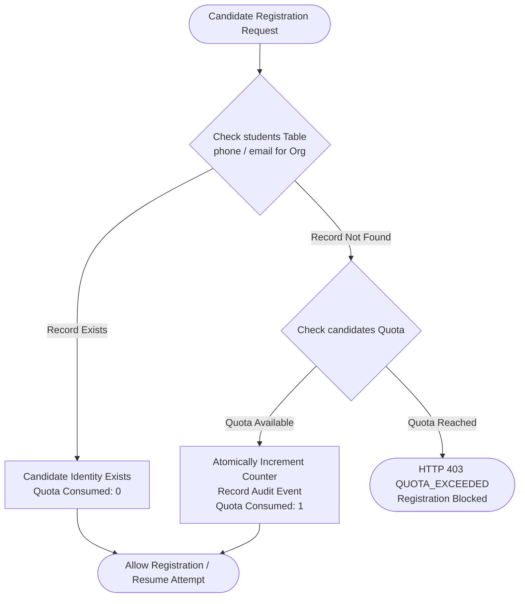
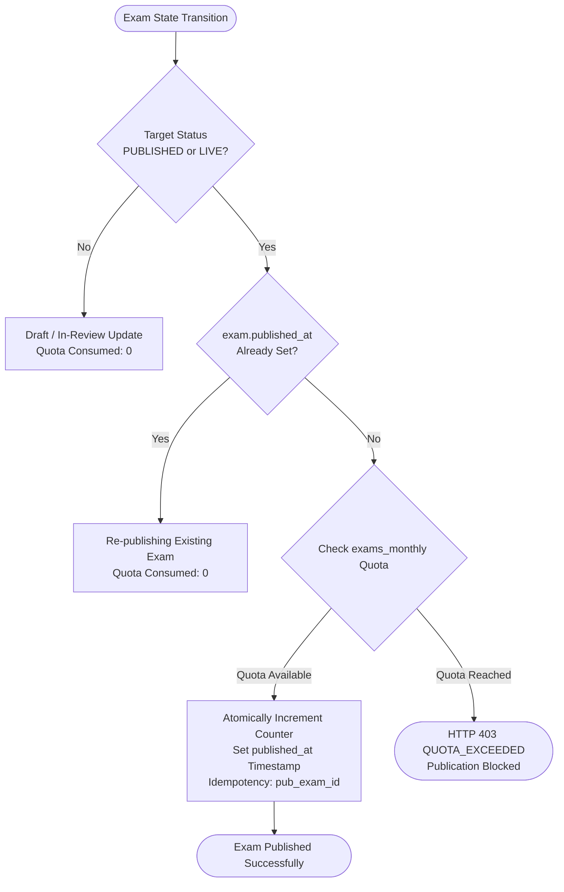
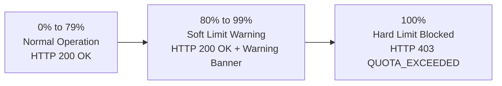

# ASPIRE BY ADYAPAN
# QUOTA & METERING POLICY
## Standard Operating Policy — Consumption Accounting, Period Boundaries, Soft/Hard Limits, and Concurrency Protections

---

## 1. Policy Purpose & Scope

This document specifies the authoritative rules for counting, reserving, consuming, and auditing SaaS resource usage across organizations on **Aspire by Adyapan**.

The quota and metering policy enforces strict data integrity:
- Quota allocations are enforced centrally at the database transaction layer.
- Over-allocation is prevented under all concurrent execution profiles.
- Legitimate student activities (such as retakes or resuming active sessions) are never double-metered.

---

## 2. Resource Metering Rules

### 2.1 Distinct Candidate Identity Metering (`candidates`)



1. **Unit of Measure:** Unique candidate record in the `students` table, scoped by `organization_id`.
2. **Deduction Trigger:** Successful execution of `POST /api/register` where no prior student record exists with the candidate's phone or email for the organization.
3. **Exemptions (0 Quota Consumed):**
   - **Retakes:** If an exam permits multiple attempts, subsequent attempts by the same candidate link to the existing `student_id` and do not consume candidate quota.
   - **Resumes:** Re-logging into an active or in-progress assessment.
   - **Multi-Exam Participation:** A student who previously took Exam 1 and later takes Exam 2 within the same organization is counted as the same distinct identity.
4. **Idempotency Guarantee:** Event key formatted as `reg_candidate_<orgId>_<phone>` ensures that network retries cannot double-consume quota.

### 2.2 Monthly Published Exam Metering (`exams_monthly`)



1. **Unit of Measure:** Distinct exam entity successfully published during the active calendar billing month.
2. **Deduction Trigger:** `transitionExamStatus` transitioning an exam to `PUBLISHED` or `LIVE` when `exam.published_at IS NULL`.
3. **Exemptions (0 Quota Consumed):**
   - **Draft Creation & Editing:** Creating sections, adding questions, configuring scholarship slabs, updating instructions.
   - **Re-publishing:** Taking a published exam back to `DRAFT` or `IN_REVIEW` for minor edits, then transitioning back to `PUBLISHED`. Because `exam.published_at` is preserved, **0 quota is consumed**.
   - **Archival:** Moving an exam to `ARCHIVED`.
4. **Idempotency Guarantee:** Event key formatted as `pub_exam_<examId>` guarantees single consumption per exam.

---

## 3. Period Boundaries & Reset Schedules

Resource counters in `organization_usage_counters` are keyed by `(organization_id, resource_key, period_start, period_end)`.

1. **Calendar Month Alignment:**
   - Period start: `YYYY-MM-01T00:00:00.000Z`
   - Period end: First second of next month `YYYY-(MM+1)-01T00:00:00.000Z`
2. **Monthly Resources (`exams_monthly`):**
   - Counters reset automatically at the beginning of each calendar month.
   - Previous month counters remain archived in SQLite for historical analytics and reporting.
3. **Cumulative / High-Water Resources (`candidates`, `storage_bytes`):**
   - Active identity counters track total distinct candidate count.
   - Quotas act as a hard ceiling against total distinct candidates enrolled by the organization.

---

## 4. Threshold Actions: Soft Limits vs. Hard Limits



### 4.1 Soft Limit Policy (Default 80%)
- When resource consumption reaches or exceeds the configured soft limit threshold (e.g. $\ge 80\%$ on Starter/Growth, $\ge 90\%$ on Enterprise):
  - Invocations are **allowed** to succeed without interruption.
  - API responses and administrative dashboards return proactive warnings (`isSoftLimit: true`, `percentage: 84%`).
  - The Admin UI renders an amber warning alert prompting the administrator to request an upgrade before hitting the ceiling.

### 4.2 Hard Limit Policy (100%)
- When resource consumption reaches $100\%$ of quota ($used \ge quota$):
  - Further consumption is **immediately blocked**.
  - Requests terminate with HTTP `403 Forbidden` and error code `QUOTA_EXCEEDED`.
  - Error Payload Schema:
    ```json
    {
      "error": "Quota limit reached for candidates. Used: 500, Allowed: 500.",
      "code": "QUOTA_EXCEEDED",
      "details": {
        "resource": "candidates",
        "limit": 500,
        "used": 500,
        "remaining": 0,
        "percentage": 100
      }
    }
    ```

---

## 5. Concurrency & Race Condition Defense

Under high-concurrency environments (such as thousands of candidates attempting to register during a synchronized entrance exam), simple `SELECT` followed by `UPDATE` suffers from race conditions.

### Aspire Atomic Locking Model:
1. Every quota check and reservation executes within a synchronous SQLite `db.transaction()` executing in immediate mode.
2. In immediate mode, SQLite obtains a reserved lock on the database file before executing write operations.
3. If an organization has 1 quota unit remaining and 10 concurrent requests arrive simultaneously:
   - Request 1 acquires the lock, reads counter (499 / 500), increments counter to 500, commits.
   - Requests 2 through 10 acquire the lock sequentially, read counter (500 / 500), evaluate `remaining === 0`, and throw `QuotaExceededError`.
   - Result: Exactly 1 request succeeds, 9 requests are rejected, and the counter never exceeds 500.

---

## 6. Tenant Downgrades, Suspensions, and Data Retention

1. **Zero Data Loss on Downgrades:**
   - Downgrading an organization from `ENTERPRISE` to `STARTER` **never deletes or prunes historical data**.
   - If an organization has 1,500 registered candidates and downgrades to Starter (limit 500), all 1,500 candidate records remain fully accessible in results, exam analytics, and reports.
   - New registrations are rejected with `QUOTA_EXCEEDED` until the organization upgrades.
2. **Suspended Organizations:**
   - A suspended subscription (`status = 'SUSPENDED'`) halts all metered operations immediately with HTTP `403 Forbidden` (`code: 'SUBSCRIPTION_INACTIVE'`).
   - Audit history and usage events remain permanently preserved.

