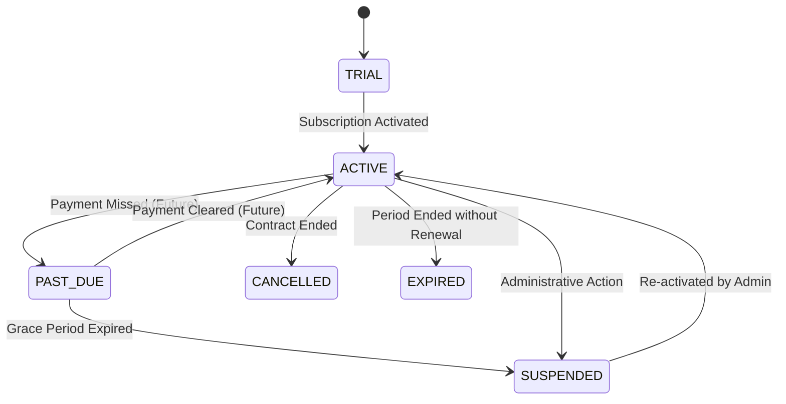

# ASPIRE BY ADYAPAN
# SUBSCRIPTION PLAN SPECIFICATION
## Comprehensive Catalog, Resource Quotas, Feature Entitlement Matrix, and Tenant Overrides

---

## 1. Plan Catalog Architecture

Aspire provides a database-backed, configurable plan catalog managed by Super Administrators. The system supports multi-tiered pricing models, custom bespoke plans for academic consortia, and tenant-level quota and feature overrides.

### Invariant: Representation of Unlimited Quotas
In the Aspire architecture, **`null` strictly denotes unlimited quota**.
- `quotas: { exams_monthly: null }` $\rightarrow$ Unlimited published exams per month.
- `quotas: { candidates: null }` $\rightarrow$ Unlimited candidates allowed.
- A numerical value `0` explicitly represents **zero units allowed** (disabled resource).
- `null` is never conflated with `0`, `false`, or undefined.

---

## 2. Standard Plan Catalog (Seeded Plans)

| Feature / Quota | Starter Plan (`STARTER`) | Growth Plan (`GROWTH`) | Enterprise Plan (`ENTERPRISE`) |
|---|---|---|---|
| **Code** | `STARTER` | `GROWTH` | `ENTERPRISE` |
| **Target Organization** | Individual Departments / Small Institutes | Growing Colleges & Test Centers | Universities, State Boards & Enterprise Consortia |
| **Organizations Allowed** | 1 Organization | 1 Organization | Multi-Organization Support |
| **Monthly Published Exams** | 3 per month | **Unlimited** (`null`) | **Unlimited** (`null`) |
| **Distinct Candidate Quota** | 500 candidates | 5,000 candidates | **Unlimited** (`null`) |
| **Storage Allocation** | 1 GB (1,073,741,824 bytes) | 10 GB (10,737,418,240 bytes) | 100 GB (107,374,182,400 bytes) |
| **Soft Limit Threshold** | 80% | 80% | 90% |
| **Hard Limit Action** | Block (HTTP 403 `QUOTA_EXCEEDED`) | Block (HTTP 403 `QUOTA_EXCEEDED`) | Block (HTTP 403 `QUOTA_EXCEEDED`) |
| **Standard Assessment** | Yes | Yes | Yes |
| **Basic Analytics** | Yes | Yes | Yes |
| **Advanced Analytics** | No | Yes | Yes |
| **Digital Certificates** | No | Yes | Yes |
| **Webcam & Tab Proctoring** | No | Yes | Yes |
| **Custom Portal Branding** | No | No | Yes |
| **Priority Support** | No | No | Yes |
| **Dedicated Infrastructure** | No | No | Yes |
| **Custom Integrations** | No | No | Yes |

---

## 3. Feature Entitlement Matrix

Functional areas are protected using `requireFeature(FEATURE_CODE)` middleware.

| Feature Code | Name | Description | Starter | Growth | Enterprise |
|---|---|---|:---:|:---:|:---:|
| `STANDARD_ASSESSMENT` | Standard Assessment | Question bank, section builder, timed test engine, automatic MCQ grading | **Yes** | **Yes** | **Yes** |
| `BASIC_ANALYTICS` | Basic Analytics | Overall candidate score breakdown, pass percentage, basic distribution | **Yes** | **Yes** | **Yes** |
| `ADVANCED_ANALYTICS` | Advanced Analytics | Cronbach's Alpha, item discrimination index, point biserial, section drilldown | No | **Yes** | **Yes** |
| `CERTIFICATES` | Digital Certificates | Automated PDF certificate generation, claim codes, signature stamps | No | **Yes** | **Yes** |
| `PROCTORING` | Proctoring Analytics | Tab-switch tracking, webcam anomaly detection, risk score calculation | No | **Yes** | **Yes** |
| `CUSTOM_BRANDING` | Custom Branding | Custom portal logos, primary/secondary colors, personalized certificate badges | No | No | **Yes** |
| `PRIORITY_SUPPORT` | Priority Support | SLA response guarantees, direct platform engineering escalations | No | No | **Yes** |
| `DEDICATED_INFRASTRUCTURE`| Dedicated Infrastructure | Isolated Redis worker queues, dedicated database instances | No | No | **Yes** |
| `CUSTOM_INTEGRATIONS` | Custom Integrations | Webhook dispatchers, SIS/ERP integration endpoints | No | No | **Yes** |

### Super Admin Privilege
Users with role `SUPER_ADMIN` possess global entitlement and bypass all feature gates, ensuring platform maintainability and administrative access.

---

## 4. Quota Resource Keys & Semantics

| Resource Key | Metering Type | Description | Idempotency Key Format |
|---|---|---|---|
| `candidates` | Distinct Identity (Count) | Number of unique candidate records in the `students` table scoped to an organization. Retakes, re-evaluations, or multiple attempts do **not** consume quota. | `reg_candidate_<orgId>_<phone>` |
| `exams_monthly` | Publication Events (Monthly Count) | Number of distinct exams published or made live within the billing calendar month. Only the first publication consumes 1 unit. Drafting and subsequent unpublishing/republishing do not consume quota. | `pub_exam_<examId>` |
| `storage_bytes` | High-Water Mark (Bytes) | Total cumulative bytes consumed by uploaded question assets, exam attachments, and candidate submission media. | `storage_upload_<fileHash>` |

---

## 5. Tenant-Level Quota & Feature Overrides

Super Administrators can customize an individual organization's allowances directly on their active subscription without creating a new plan definition.

### Resolution Precedence:
$$\text{Effective Resource Quota} = \text{Tenant Override Quota} \mathbin{\Vert} \text{Plan Quota}$$
$$\text{Effective Features} = \text{Plan Features} \cup \text{Tenant Override Features}$$

- If an override specifies `override_quotas: { candidates: 1200 }`, the effective candidate quota becomes 1,200.
- If an override specifies `override_quotas: { exams_monthly: null }`, the tenant receives unlimited monthly exams even while on Starter.
- If an override specifies `override_features: ["CUSTOM_BRANDING"]`, a Starter tenant is granted custom branding privileges.

---

## 6. Plan State Transitions & Data Retention Policy

### Data Retention & Zero Data Loss Guarantee
- **Downgrades:** When an organization downgrades (e.g. from Growth to Starter), **no existing candidate data, exams, questions, or certificate records are deleted**.
- **Quotas Enforce Ceilings, Not Purges:** If an organization with 800 existing students downgrades to a Starter plan (limit 500), all 800 existing candidate records remain fully readable and searchable. The quota enforcement engine merely blocks registration of new candidate identity #801 until quota is expanded.
- **Suspension:** A suspended subscription restricts new write operations (exam publishing, candidate registration) with HTTP 403 `SUBSCRIPTION_INACTIVE`, while preserving complete historical records.

