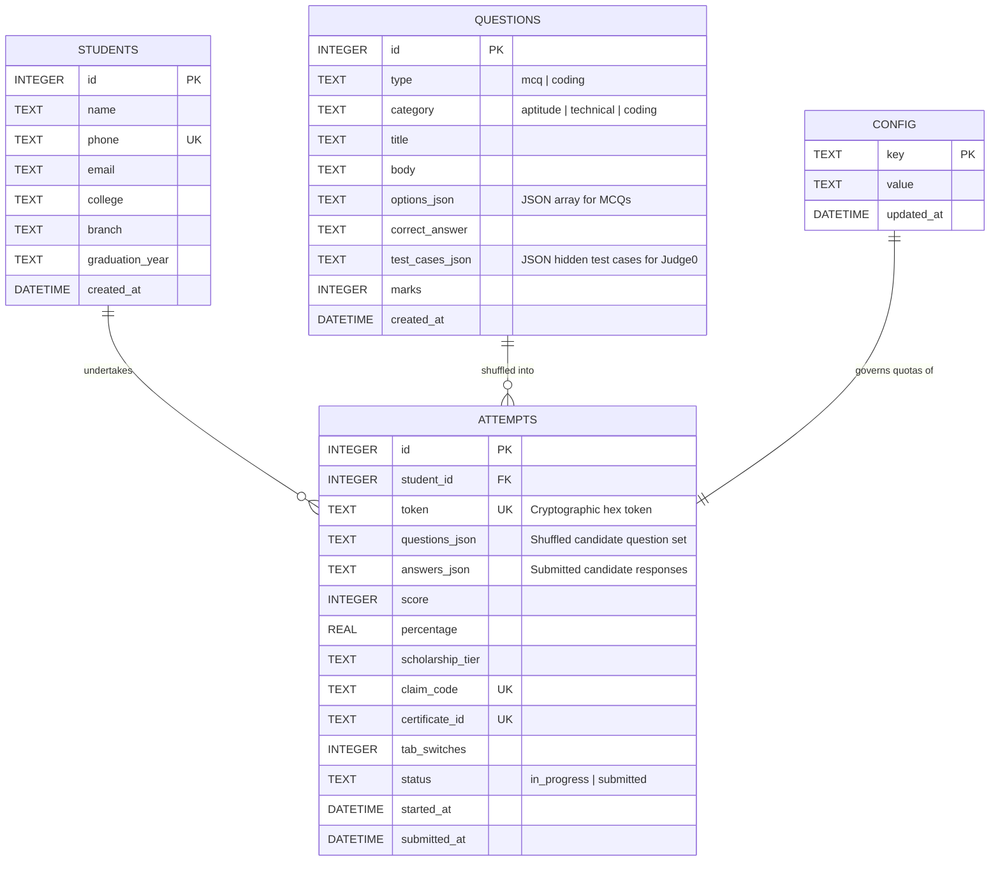

# Aspire by Adyapan — System Design & Architecture Specification

> **Document Version:** 1.0.0  
> **Platform:** Aspire by Adyapan (*"Aspire. Achieve. Adyapan."*)  
> **Scope:** UI/UX Design System, Frontend Component Architecture, Backend Systems Design, Data Models, and Security Protocols.

---

## 1. Executive Summary & Product Vision

**Aspire by Adyapan** is an automated, high-integrity scholarship evaluation and technical assessment SaaS platform. It eliminates human intervention from the testing lifecycle:

```text
Student Registration
        ↓
Instructions & System Readiness
        ↓
Timed Proctored Assessment Room
(Aptitude MCQs + Technical MCQs + Judge0 Coding)
        ↓
Server-Side Auto-Grading & Atomic Submission Lock
        ↓
Instant Result & Scholarship Tier Assignment
        ↓
Scholarship Claim Code + Branded PDF Certificate
        ↓
Admin Management, Question Bank CRUD & College Analytics
```

### Key Design Tenets
1. **Zero-Friction Candidate Experience**: Minimalist, fast, mobile-responsive Vanilla JS frontend with zero build step dependencies and instant time-to-first-byte (TTFB).
2. **Defensive Assessment Integrity**: Strict single-attempt enforcement per mobile number, atomic database-level submission locking, anti-cheat tab-switch detection, and server-side execution via isolated Judge0 runners.
3. **High Visual Polish & Trust**: Branded topbars, legible typography, responsive question palettes, dynamic timer states, and print-ready high-DPI vector certificates.
4. **Resilient Production Baseline**: Layered security pipeline (Helmet, CORS allowlists, multi-tiered rate limiting, request size boundaries, Zod schema validation, and SQLite Write-Ahead Logging).

---

## 2. Brand Identity & Design Tokens

The visual language balances academic credibility with a modern, high-focus assessment interface.

### 2.1 Color Palette

```css
:root {
  /* Brand Primary & Accents */
  --primary:          #FDA2AC; /* Soft Strawberry Pink - Gentle brand highlight, secondary cards, soft accent */
  --primary-light:    #FFF0F2; /* Ultra-soft strawberry tint - Option selection backgrounds, answered badge highlights */
  --crimson:          #CB0E31; /* Vibrant Crimson Red - High-contrast CTA buttons, primary logo accent, timer danger */
  --crimson-hover:    #A50A26; /* Deep Crimson - Hover & active button press states */
  --lime:             #BAD62C; /* Lime Green - Vibrant energetic accent, answered question states, scholarship badges, success states */
  --lime-light:       #F7FCE8; /* Soft lime tint - Progress indicators, category average highlights */

  /* Neutral & Dark System Surfaces */
  --topbar-bg:        #111827; /* Dark Slate 900 - Header Bar & Sticky Timer */
  --code-bg:          #1F2937; /* Dark Slate 800 - Code Editor Container */
  --ink:              #1F2937; /* Charcoal 800 - Primary Body Copy */
  --muted:            #6B7280; /* Cool Gray 500 - Metadata, Labels, Subtext */
  --line:             #E5E7EB; /* Border Gray 200 - Dividers, Card Outlines */
  --bg:               #FAFAF9; /* Canvas Off-White - Page Background */
  --card:             #FFFFFF; /* Pure White - Content Surfaces */

  /* Semantic Feedback Tokens */
  --ok:               #BAD62C; /* Lime Green - Validations, Success Toasts, Completed states */
  --ok-bg:            #F7FCE8; /* Light Lime Tint */
  --warn:             #D97706; /* Amber 600 - Warnings, Proctoring Alerts */
  --warn-bg:          #FFFBEB; /* Light Amber Tint */
  --bad:              #CB0E31; /* Vibrant Crimson Red - Validation Errors, Timer Danger */
  --bad-bg:           #FFF0F2; /* Soft Strawberry / Crimson Light Tint */
}
```

### 2.2 Typography Hierarchy (Inter + Tempting)

Aspire employs a modern, expressive typographic pairing:
- **Display & Headings**: `'Tempting', cursive, serif` — used for brand wordmarks, hero score displays (`.score-big`), celebratory scholarship badges, certificate headers, and high-impact section titles (`h1`, `h2`).
- **Body & UI Elements**: `'Inter', system-ui, -apple-system, sans-serif` — provides ultra-clear legibility for question text, MCQ radio options, form inputs, labels, data tables, and timer numerals.
- **Code / Monospace**: `'Consolas', 'Menlo', 'Courier New', monospace` (line-height: `1.5`, letter-spacing: `-0.02em`) for the in-browser coding IDE and technical problem statements.

| Element | Size | Weight / Style | Line Height | Font Family | Usage |
| :--- | :--- | :--- | :--- | :--- | :--- |
| **Hero Metric (`.score-big`)** | 52px | 800 / Bold | 1.1 | **Tempting** | Final assessment score & scholarship percentage |
| **Page Title (`h1`)** | 28px | 700 / Bold | 1.25 | **Tempting** | Form headers, Results title, Welcome greeting |
| **Section Title (`h2`)** | 22px | 700 / Bold | 1.3 | **Tempting** | Category headers, Admin tab headers |
| **Timer Display (`.timer`)** | 18px | 700 | 1.0 | **Inter** | Sticky countdown clock |
| **Question Prompt (`.qtext`)** | 17px | 400 / Regular | 1.6 | **Inter** | Question instructions, technical prompts |
| **Input & Buttons (`input, .btn`)**| 16px | 600 / 700 | 1.2 | **Inter** | Candidate inputs, primary CTA actions |
| **Body & Options (`.opt`)** | 15px | 400 / Regular | 1.5 | **Inter** | MCQ option choices, table records |
| **Code Editor (`textarea.code`)** | 14px | 400 / Regular | 1.5 | **Monospace**| In-browser coding question IDE |
| **Metadata & Subtext (`.sub, label`)** | 13px | 600 / Medium | 1.4 | **Inter** | Form labels, helper captions, proctoring notes |

### 2.3 Spacing, Borders & Elevation

- **Max Content Width**: `860px` centered (`margin: 32px auto; padding: 0 16px`)
- **Card Surface**: Background `#FFFFFF`, border `1px solid var(--line)`, radius `14px`, shadow `0 2px 10px rgba(0,0,0,0.04)`
- **Interactive Radii**:
  - `8px`: Palette buttons, category tags, logos
  - `9px`: Inputs, select dropdowns, MCQ option cards
  - `10px`: Primary CTA buttons, notification toasts
  - `999px`: Scholarship badges, status pills
- **Transitions**: `all 0.15s ease-in-out` on interactive controls (buttons, options, tabs)

---

## 3. UX Architecture & User Flows

### 3.1 Candidate Experience Flow

```mermaid
graph TD
    A[index.html: Registration] -->|Zod Validate + Atomic Insert| B[instructions.html: Test Briefing]
    B -->|Check Quotas & Judge0| C[test.html: Timed Assessment Room]
    C -->|Auto-Submit or Manual Submit| D[Server-Side Auto-Grading & Locking]
    D -->|Calculate Scholarship Tier| E[result.html: Score & Claim Code]
    E -->|Download PDF| F[/api/certificate/:id: Vector Certificate]
```

#### 1. Registration (`index.html`)
- Fields: Full Name, 10-Digit Mobile Number (starting with 6–9), Email, College, Branch/Degree, Graduation Year.
- **Single-Attempt Guard**: The phone number acts as an idempotent identifier. If an attempt already exists, an informative dialog guides the candidate back to their active session or completed result.

#### 2. Instructions & Environment Check (`instructions.html`)
- Communicates test quotas (default: **10 Aptitude + 25 Technical MCQ + 5 Coding**).
- Full disclosure of anti-cheat proctoring: tab switching, window blurring, and clipboard tracking.
- System check verification (connectivity test and viewport size validation).

#### 3. Timed Assessment Room (`test.html`)
- **Sticky Top Bar**: Displays student name, live countdown clock (default 90 min), and emergency submit button. Turns crimson (`.timer.danger`) when less than 5 minutes remain.
- **Question Palette**: An accessible 40-cell grid displaying:
  - White / Gray border: Unanswered.
  - Vibrant Crimson border (`.current`): Currently active question.
  - Lime Green tint background (`.answered`): Completed question (`--lime` / `--lime-light`).
- **MCQ Interface**: Accessible option cards with radio selection highlighting (`--primary-light` background and `--primary` strawberry pink border with `--crimson` focus).
- **Coding Question IDE**: Monospace text area with tab key support, language selector (Python, Java, C++, JavaScript), problem statement, input/output constraints, and visible sample test cases.
- **Proctoring Engine**: Tracks `document.visibilitychange` and `window.blur`. Issues progressive toast warnings and persists tab-switch counts upon final submission.
- **Auto-Submit Guard**: Triggers automated payload submission immediately upon timer reaching `00:00:00`.

#### 4. Instant Results & Scholarship Allocation (`result.html`)
- Instant calculation: Score breakdown (Aptitude %, Technical %, Coding %).
- Dynamic Scholarship Tier Badge:
  - **90%+**: 100% Scholarship Tier
  - **75%–89%**: 50% Scholarship Tier
  - **60%–74%**: 25% Scholarship Tier
  - **40%–59%**: 10% Scholarship Tier
- Cryptographically generated Scholarship Claim Code (`CLAIM-XXXXX`).
- One-click PDF Certificate download button.

#### 5. Admin Control Center (`admin.html`)
- Protected by `x-admin-token` authentication header.
- **Tab 1: Question Bank**: CRUD for Aptitude, Technical MCQs, and Coding questions.
- **Tab 2: Test Configuration**: Live adjustment of test duration, category quotas, and tier slabs.
- **Tab 3: Results & Analytics**: Filterable results table (by college, branch, score threshold).
- **Tab 4: Batch Export**: One-click CSV download and college skill batch reports.
- **Tab 5: System Status**: Live Judge0 API health check and latency gauge.

---

## 4. Frontend Component Inventory

| Component | Selector / Class | State Variants | Behavioral Contract |
| :--- | :--- | :--- | :--- |
| **TopBar** | `.topbar` | Fixed, Dark Theme | Displays Adyapan logo, tagline, and candidate context. |
| **Timer** | `.timer` | Normal, `.danger` | Sticky counter; transitions to red pulse when remaining time < 300s. |
| **Card** | `.card` | Default | Standard white elevation container for forms and test questions. |
| **Button** | `.btn` | Default, `.ghost`, `.small`, `:disabled` | Primary CTA with hover darkening and disabled state prevention. |
| **Palette Button**| `.pal-btn` | Default, `.current`, `.answered` | Jump navigation between test questions; indicates completion state. |
| **MCQ Option** | `.opt` | Default, `:hover`, `.selected` | Full-row clickable radio container with instant active state styling. |
| **Code Editor** | `textarea.code`| Monospace, Dark | Tab indentation handling, disabled spellcheck, syntax container. |
| **Toast** | `.toast` | Hidden, Visible | Transient alerts for proctoring warnings and auto-save confirmations. |
| **Badge** | `.badge` | Default | Rounded pill displaying earned scholarship tier. |
| **Data Table** | `table.data` | Striped, Filtered | Admin grid for candidate performance records and question banks. |

---

## 5. Backend Architecture & Pipeline

Aspire follows an asynchronous, modular Node.js/Express architecture:

```text
HTTP Request
     ↓
trust proxy (Reverse Proxy Support)
     ↓
requestIdMiddleware (Generates unique trace ID 'req_...')
     ↓
Helmet Security Headers (CSP, Frameguard 'DENY', NoSniff, Referrer 'same-origin')
     ↓
Permissions-Policy (Disables camera, mic, geolocation, payments)
     ↓
CORS Middleware (Explicit Origin Allowlist via CORS_ORIGIN)
     ↓
Public API Rate Limiter (300 req / 15 min)
     ↓
Body Limit Boundary (JSON: 512KB, URL-encoded: 128KB)
     ↓
Static Asset Pipeline (Vanilla HTML, CSS, JS)
     ↓
Route-Specific Rate Limiters:
  • /api/register          → 15 req / 15 min
  • /api/attempt/:t/submit → 10 req / 1 min
  • /api/admin/*           → 40 req / 15 min
  • /api/certificate/:id   → 30 req / 5 min
     ↓
Authentication & Authorization (Admin token check, Attempt token verification)
     ↓
Zod Request Validation (Strict body, query, and parameter schema checks)
     ↓
Contextual Sanitization (Null-byte stripping, SQL LIKE wildcard escaping)
     ↓
Atomic Business Logic (Single attempt, Submission lock, Judge0 runner)
     ↓
Database Prepared Statements (better-sqlite3, WAL mode)
     ↓
Centralized Error Handler (Standardized JSON error contract, no leaked internals)
```

---

## 6. Database Schema & Data Models

Engine: **SQLite 3 via `better-sqlite3`**  
Configuration: `PRAGMA journal_mode = WAL; PRAGMA foreign_keys = ON; PRAGMA busy_timeout = 5000;`



---

## 7. Security & Integrity Engineering

### 7.1 Single-Attempt & Atomic Submission Locking
- **Registration**: Wrapped in SQLite transaction. A unique index on `students.phone` guarantees a single attempt per phone number.
- **Submission**: Employs an atomic condition `UPDATE attempts SET status = 'submitted' WHERE token = ? AND status = 'in_progress'`. If zero rows are modified, secondary submissions are rejected immediately, preventing race conditions.

### 7.2 Judge0 Code Execution Shielding
- Judge0 API credentials never reach the browser.
- Multi-layer defense:
  1. Rate limiting on the submission endpoint (10 req / min).
  2. Max 64KB code size limit per question in Zod validation.
  3. Execution caps (5s CPU time limit, 128MB memory limit per test case).
  4. Graceful fallback: If Judge0 is unreachable or disabled, coding questions are skipped from scoring without breaking the test session.

### 7.3 Content Security Policy (CSP)
- `default-src 'self'`: Restricts loading external unauthorized assets.
- `script-src 'self' 'unsafe-inline'`: Enables local assessment scripts without allowing arbitrary remote scripts.
- `style-src 'self' 'unsafe-inline'`: Supports dynamic proctoring colors and responsive layout styles.
- `img-src 'self' data: blob:`: Allows vector SVG logos and local certificate previews.
- `frame-ancestors 'none'`: Comprehensive clickjacking defense.
- `object-src 'none'`: Disables dangerous legacy browser plugin execution.

---

## 8. PDF Certificate Generation Engine

Certificates are generated on-demand using **PDFKit** at `/api/certificate/:certificateId`:
- **Canvas Dimensions**: Standard Landscape A4 (`841.89 x 595.28` pt).
- **Resolution**: 300+ DPI vector graphics.
- **Visual Structure**:
  - Outer border with branded triple accent insets (`#CB0E31` Vibrant Crimson, `#BAD62C` Lime Green, and `#FDA2AC` Strawberry Pink).
  - Top header: *"Certificate of Achievement"* set in **Tempting**.
  - Candidate details: Full Name, College, and Branch set in **Inter**.
  - Performance: Scholarship Percentage, Qualification Tier, and Date.
  - Verification: Cryptographic Certificate ID (`CERT-...`) and verification URL.
- **Streaming Response**: Generated in memory and streamed with `Content-Type: application/pdf` and `Content-Disposition: inline`.

---

## 9. Accessibility & Responsiveness Specifications

- **Responsive Viewports**: Tested across Mobile (`360px - 640px`), Tablet (`641px - 1024px`), and Desktop (`1025px+`).
- **Form Controls**: Fully accessible via keyboard tab navigation (`tabindex`, `:focus-visible` with 2px accent outlines).
- **Contrast Ratios**: Body text (`#1F2937` on `#FFFFFF` / `#FAFAF9`) achieves a **10.5:1** contrast ratio (exceeding WCAG AAA standard of 7:1).
- **Screen Reader Support**: Semantic HTML structure (`<header>`, `<main>`, `<fieldset>`, `<legend>`, `<label>`).

---

## 10. Operational Checklist & Verification

- [x] Responsive layout verified on mobile, tablet, and desktop viewports.
- [x] Security headers and CSP verified without console violations.
- [x] Single-attempt enforcement tested under concurrent network conditions.
- [x] PDF certificate generation verified with dynamic candidate data.
- [x] Judge0 code compilation sandboxed and shielded from client abuse.
- [x] All 98+ automated test assertions pass cleanly with zero warnings.
