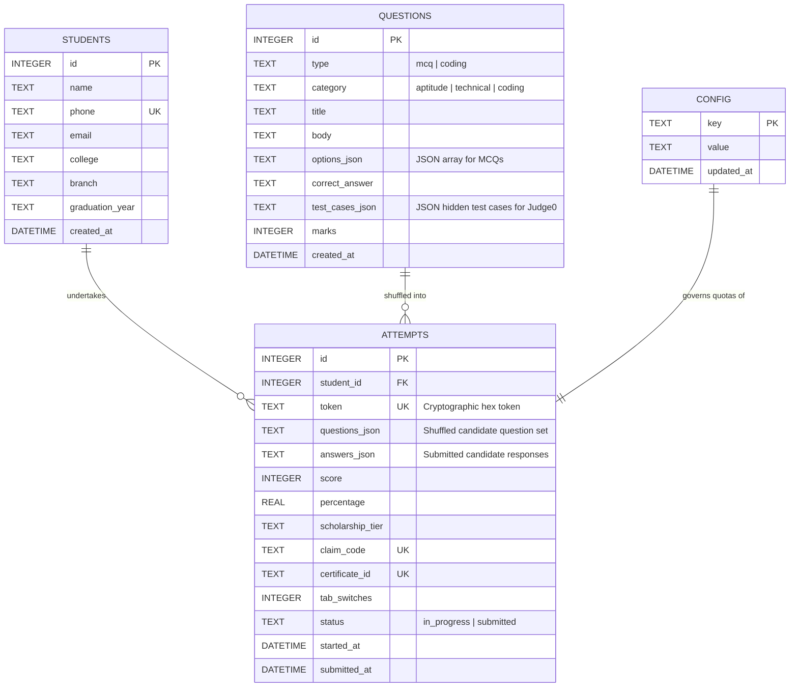

# Aspire by Adyapan — System Design & Architecture Specification
Document Version: 1.0.0  

Platform: Aspire by Adyapan ("Aspire. Achieve. Adyapan.")  

Scope: UI/UX Design System, Frontend Component Architecture, Backend Systems Design, Data Models, and Security Protocols.

## 1. Executive Summary & Product Vision

Aspire by Adyapan is an automated, high-integrity scholarship evaluation and technical assessment SaaS platform. It eliminates human intervention from the testing lifecycle:

Student Registration

        ↓

Instructions & System Readiness

        ↓

Timed Proctored Assessment Room

(Aptitude MCQs + Technical MCQs + Judge0 Coding)

        ↓

Server-Side Auto-Grading & Atomic Submission Lock

        ↓

Instant Result & Scholarship Tier Assignment

        ↓

Scholarship Claim Code + Branded PDF Certificate

        ↓

Admin Management, Question Bank CRUD & College Analytics

### Key Design Tenets
1. Zero-Friction Candidate Experience: Minimalist, fast, mobile-responsive Vanilla JS frontend with zero build step dependencies and instant time-to-first-byte (TTFB).
2. Defensive Assessment Integrity: Strict single-attempt enforcement per mobile number, atomic database-level submission locking, anti-cheat tab-switch detection, and server-side execution via isolated Judge0 runners.
3. High Visual Polish & Trust: Branded topbars, legible typography, responsive question palettes, dynamic timer states, and print-ready high-DPI vector certificates.
4. Resilient Production Baseline: Layered security pipeline (Helmet, CORS allowlists, multi-tiered rate limiting, request size boundaries, Zod schema validation, and SQLite Write-Ahead Logging).
**## 2. Brand Identity & Design Tokens

Aspire's visual identity is built around a confident editorial aesthetic: midnight black for authority, warm white for clarity, and vibrant golden yellow for energy and emphasis. The interface should feel premium, focused, trustworthy, and modern—not playful or overly decorative.
2.1 Color Palette
The three brand colors are the foundation of the interface. Use semantic colors only for functional feedback; do not let them compete with the brand palette.
:root {
  /* Core brand colors */
  --primary: #08090B;          /* Midnight black: primary brand color, navigation, dark surfaces */
  --secondary: #F5F3EF;        /* Warm pure-white: main light canvas and light surface */
  --accent: #FFC900;           /* Vibrant golden yellow: primary accent and key actions */

  /* Brand interaction states */
  --primary-hover: #17191D;    /* Lifted midnight black for hover */
  --accent-hover: #E6B500;     /* Deeper gold for hover/pressed states */
  --accent-soft: #FFF4C2;      /* Soft gold tint for selected and highlighted surfaces */
  --accent-strong: #D9A900;    /* Gold for restrained emphasis on light surfaces */

  /* Neutral surfaces and text */
  --bg: #F5F3EF;                /* Main application canvas */
  --surface: #FFFFFF;           /* Cards, dialogs, tables, and form surfaces */
  --surface-muted: #ECEAE5;     /* Subtle alternate surface */
  --ink: #08090B;               /* Primary text */
  --ink-secondary: #34363A;     /* Secondary body text */
  --muted: #777873;             /* Metadata, helper text, placeholders */
  --line: #DEDCD5;              /* Borders and dividers */
  --line-strong: #BDBAB1;        /* Emphasized borders */
  --topbar-bg: #08090B;          /* Header/navigation */
  --topbar-ink: #F5F3EF;         /* Header text and icons */
  --code-bg: #111318;            /* Code editor surface */
  --code-ink: #F5F3EF;           /* Code editor text */

  /* Semantic feedback: reserved for meaning, not decoration */
  --ok: #237A45;
  --ok-bg: #EAF5ED;
  --warn: #A96500;
  --warn-bg: #FFF4DE;
  --bad: #C62828;
  --bad-bg: #FDECEC;
  --info: #245C9C;
  --info-bg: #EAF1FA;

  /* Focus and elevation */
  --focus-ring: rgba(255, 201, 0, 0.55);
  --shadow-sm: 0 2px 8px rgba(8, 9, 11, 0.06);
  --shadow-md: 0 8px 24px rgba(8, 9, 11, 0.10);
  --shadow-lg: 0 18px 48px rgba(8, 9, 11, 0.14);
}
Color usage rules
- Midnight black (#08090B) is the primary brand anchor. Use it for the main navigation, dark hero sections, headings, primary dark buttons, and high-contrast structural areas.
- Warm white (#F5F3EF) is the default page canvas and the principal light brand surface. Use pure #FFFFFF for cards, modals, tables, and form controls when separation from the canvas is useful.
- Golden yellow (#FFC900) is the signature accent. Use it for primary highlights, selected states, progress indicators, active navigation markers, key metrics, small graphic details, and important calls to action.
- Use gold with midnight-black text for buttons and labels. Do not use white text on gold; the contrast is insufficient for small text.
- Do not use gold as a large body-text color. Keep long-form text midnight black or dark neutral.
- Keep semantic success, warning, error, and informational colors distinct from the brand gold. Gold is not a substitute for every warning state.
- Avoid introducing additional decorative brand colors, gradients, or pink/semantic danger/success remnants. Gradients are optional and should be subtle, using only black, warm white, and gold.
- Maintain clear contrast for all text, icons, borders, and interactive states.
2.2 Typography Hierarchy (Playfair Display + Poppins)
Aspire uses an editorial serif and a clean geometric sans-serif pairing:
- Display & Headings: Playfair Display, Georgia, serif. Use for the brand wordmark where appropriate, hero headlines, page titles, major section headings, result score highlights, scholarship presentation, and certificate titles.
- Body & UI: Poppins, system-ui, sans-serif. Use for paragraphs, navigation, labels, buttons, forms, question text, options, tables, dashboards, and all operational interface elements.
- Code / Monospace: Consolas, Menlo, Courier New, monospace. Use for code editors and code-oriented technical content.
Load Playfair Display and Poppins from the approved font source configured by the project. Provide local/system fallbacks and ensure the application remains readable if the font request fails. Avoid applying Playfair Display to dense data tables, form labels, timer digits, or long question text.
:root {
  --font-display: "Playfair Display", Georgia, serif;
  --font-body: "Poppins", system-ui, -apple-system, BlinkMacSystemFont, "Segoe UI", sans-serif;
  --font-mono: "Consolas", "Menlo", "Courier New", monospace;
}

body {
  font-family: var(--font-body);
  color: var(--ink);
  background: var(--bg);
}

h1, h2, h3, .display, .score-big, .certificate-title {
  font-family: var(--font-display);
}

button, input, select, textarea, table {
  font-family: var(--font-body);
}

textarea.code, pre, code {
  font-family: var(--font-mono);
}
Element	Size	Weight / Style	Line Height	Font Family	Usage
Hero metric (.score-big)	52px	700 / Bold	1.1	Playfair Display	Final score and scholarship percentage
Page title (h1)	32px	700 / Bold	1.2	Playfair Display	Page headings, welcome and result title
Section title (h2)	24px	600 / Semi-bold	1.3	Playfair Display	Major sections and dashboard panels
Subsection title (h3)	18px	600 / Semi-bold	1.35	Poppins	Cards, forms, analytics widgets
Timer (.timer)	18px	600 / Semi-bold	1.0	Poppins	Sticky countdown clock; use tabular numerals
Question prompt (.qtext)	16px	400 / Regular	1.7	Poppins	Questions and technical prompts
Inputs and buttons	14–16px	500–600	1.4	Poppins	Candidate and admin controls
Body and options (.opt)	14–15px	400 / Regular	1.6	Poppins	MCQ options, descriptions, table records
Code editor (textarea.code)	14px	400 / Regular	1.5	Monospace	Coding question IDE
Metadata and subtext	12–13px	400–500	1.45	Poppins	Helper captions, timestamps, proctoring notes


2.3 Spacing, Borders & Elevation
- Application layout: Use a responsive, fluid layout. Candidate assessment content may retain a focused reading width around 860px; the admin dashboard and analytics views should use the available desktop width with a sensible maximum container width.
- Card surface: var(--surface), 1px solid var(--line), radius 14px, and var(--shadow-sm). Use stronger elevation only for overlays, menus, and dialogs.
- Dark surfaces: Use var(--primary) with var(--topbar-ink) for navigation, hero bands, and selected high-emphasis panels. Use gold sparingly for active indicators and key data.
- Poppinsactive radii:
  - 8px: palette buttons, category tags, compact controls
  - 10px: inputs, select dropdowns, MCQ option cards
  - 12px: primary CTA buttons and notification toasts
  - 14–18px: cards and dashboard panels
  - 999px: scholarship badges and status pills
- Borders: Prefer subtle neutral borders. Use a gold border or soft gold background only for selected, focused, or especially important states.
- Transitions: 150–200ms ease for color, border, shadow, and transform changes. Respect prefers-reduced-motion.
- Visual restraint: Avoid excessive shadows, ornamental gradients, multiple competing accent colors, and unnecessary rounded-pill styling. The interface should remain premium and functional.
--- | :--- | :--- | :--- | :--- | :--- |

| Hero Metric (.score-big) | 52px | 800 / Bold | 1.1 | Playfair Display | Final assessment score & scholarship percentage |

| Page Title (h1) | 28px | 700 / Bold | 1.25 | Playfair Display | Form headers, Results title, Welcome greeting |

| Section Title (h2) | 22px | 700 / Bold | 1.3 | Playfair Display | Category headers, Admin tab headers |

| Timer Display (.timer) | 18px | 700 | 1.0 | Poppins | Sticky countdown clock |

| Question Prompt (.qtext) | 17px | 400 / Regular | 1.6 | Poppins | Question instructions, technical prompts |

| Input & Buttons (input, .btn)| 16px | 600 / 700 | 1.2 | Poppins | Candidate inputs, primary CTA actions |

| Body & Options (.opt) | 15px | 400 / Regular | 1.5 | Poppins | MCQ option choices, table records |

| Code Editor (textarea.code) | 14px | 400 / Regular | 1.5 | Monospace| In-browser coding question IDE |

| Metadata & Subtext (.sub, label) | 13px | 600 / Medium | 1.4 | Poppins | Form labels, helper captions, proctoring notes |

### 2.3 Spacing, Borders & Elevation
- Max Content Width: 860px centered (margin: 32px auto; padding: 0 16px)
- Card Surface: Background #FFFFFF, border 1px solid var(--line), radius 14px, shadow 0 2px 10px rgba(0,0,0,0.04)
- Poppinsactive Radii:
  - 8px: Palette buttons, category tags, logos

  - 9px: Inputs, select dropdowns, MCQ option cards

  - 10px: Primary CTA buttons, notification toasts

  - 999px: Scholarship badges, status pills
- Transitions: all 0.15s ease-in-out on interactive controls (buttons, options, tabs)
**### 2.4 Frontend Redesign Implementation Rules
- Treat this document as the source of truth for the visual redesign. Centralize colors, typography, radii, spacing, shadows, and focus styles as CSS custom properties; do not scatter hard-coded brand values across page styles.
- Apply the new visual system consistently across candidate pages, assessment room, results, certificates, organization admin, Super Admin, question bank, exam builder, and all analytics dashboards.
- Preserve all existing routes, API contracts, authentication flows, role permissions, tenant boundaries, exam behavior, proctoring, autosave, offline recovery, timer authority, submission locking, grading, coding execution, and certificate verification.
- This is a visual-system update, not permission to replace Vanilla JS, introduce a frontend framework/build step, or change backend/database behavior.
- Audit every existing stylesheet and component for old pink, crimson, lime, Inter, and Tempting tokens. Remove them from brand styling. Keep red/green/amber/blue only where they communicate semantic status and are accessible.
- Verify the final UI in mobile, tablet, and desktop sizes, including keyboard focus, disabled/loading/error states, charts, tables, empty states, and dialogs.
3. UX Architecture & User Flows**
### 3.1 Candidate Experience Flow
```mermaid

graph TD

    A[index.html: Registration] -->|Zod Validate + Atomic Insert| B[instructions.html: Test Briefing]

    B -->|Check Quotas & Judge0| C[test.html: Timed Assessment Room]

    C -->|Auto-Submit or Manual Submit| D[Server-Side Auto-Grading & Locking]

    D -->|Calculate Scholarship Tier| E[result.html: Score & Claim Code]

    E -->|Download PDF| F[/api/certificate/:id: Vector Certificate]

```
#### 1. Registration (index.html)
- Fields: Full Name, 10-Digit Mobile Number (starting with 6–9), Email, College, Branch/Degree, Graduation Year.
- Single-Attempt Guard: The phone number acts as an idempotent identifier. If an attempt already exists, an informative dialog guides the candidate back to their active session or completed result.
#### 2. Instructions & Environment Check (instructions.html)
- Communicates test quotas (default: 10 Aptitude + 25 Technical MCQ + 5 Coding).
- Full disclosure of anti-cheat proctoring: tab switching, window blurring, and clipboard tracking.
- System check verification (connectivity test and viewport size validation).
#### 3. Timed Assessment Room (test.html)
- Sticky Top Bar: Displays student name, live countdown clock (default 90 min), and emergency submit button. Uses the semantic danger color (.timer.danger) when less than 5 minutes remain.
- Question Palette: An accessible 40-cell grid displaying:
  - Neutral surface with a subtle border: unanswered.

  - Midnight-black border with a gold active marker (.current): currently active question.

  - Soft gold tint background (.answered): completed question (--accent-soft), with a clear non-color indicator.
- MCQ Poppinsface: Accessible option cards with radio selection highlighting (--accent-soft background, midnight-black text, and a visible gold focus ring).
- Coding Question IDE: Monospace text area with tab key support, language selector (Python, Java, C++, JavaScript), problem statement, input/output constraints, and visible sample test cases.
- Proctoring Engine: Tracks document.visibilitychange and window.blur. Issues progressive toast warnings and persists tab-switch counts upon final submission.
- Auto-Submit Guard: Triggers automated payload submission immediately upon timer reaching 00:00:00.
#### 4. Instant Results & Scholarship Allocation (result.html)
- Instant calculation: Score breakdown (Aptitude %, Technical %, Coding %).
- Dynamic Scholarship Tier Badge:
  - 90%+: 100% Scholarship Tier

  - 75%–89%: 50% Scholarship Tier

  - 60%–74%: 25% Scholarship Tier

  - 40%–59%: 10% Scholarship Tier
- Cryptographically generated Scholarship Claim Code (CLAIM-XXXXX).
- One-click PDF Certificate download button.
#### 5. Admin Control Center (admin.html)
- Protected by x-admin-token authentication header.
- Tab 1: Question Bank: CRUD for Aptitude, Technical MCQs, and Coding questions.
- Tab 2: Test Configuration: Live adjustment of test duration, category quotas, and tier slabs.
- Tab 3: Results & Analytics: Filterable results table (by college, branch, score threshold).
- Tab 4: Batch Export: One-click CSV download and college skill batch reports.
- Tab 5: System Status: Live Judge0 API health check and latency gauge.
## 4. Frontend Component Inventory

| Component | Selector / Class | State Variants | Behavioral Contract |

| :--- | :--- | :--- | :--- |

| TopBar | .topbar | Fixed, Midnight Theme | Displays Adyapan logo, tagline, and candidate context; active markers use golden yellow. |

| Timer | .timer | Normal, .danger | Sticky counter; transitions to red pulse when remaining time < 300s. |

| Card | .card | Default | Warm-white/white elevation container for forms, questions, and dashboard panels. |

| Button | .btn | Default, .ghost, .small, :disabled | Primary CTA uses gold with midnight-black text (or midnight black with warm-white text); hover and disabled states remain clearly distinguishable. |

| Palette Button| .pal-btn | Default, .current, .answered | Jump navigation between test questions; indicates completion state. |

| MCQ Option | .opt | Default, :hover, .selected | Full-row clickable radio container with instant active state styling. |

| Code Editor | textarea.code| Monospace, Dark | Tab indentation handling, disabled spellcheck, syntax container. |

| Toast | .toast | Hidden, Visible | Transient alerts for proctoring warnings and auto-save confirmations. |

| Badge | .badge | Default | Rounded pill displaying earned scholarship tier; use gold with black text for the primary awarded tier. |

| Data Table | table.data | Striped, Filtered | Admin grid for candidate performance records and question banks. |
## 5. Backend Architecture & Pipeline

Aspire follows an asynchronous, modular Node.js/Express architecture:

HTTP Request

     ↓

trust proxy (Reverse Proxy Support)

     ↓

requestIdMiddleware (Generates unique trace ID 'req\_...')

     ↓

Helmet Security Headers (CSP, Frameguard 'DENY', NoSniff, Referrer 'same-origin')

     ↓

Permissions-Policy (Disables camera, mic, geolocation, payments)

     ↓

CORS Middleware (Explicit Origin Allowlist via CORS_ORIGIN)

     ↓

Public API Rate Limiter (300 req / 15 min)

     ↓

Body Limit Boundary (JSON: 512KB, URL-encoded: 128KB)

     ↓

Static Asset Pipeline (Vanilla HTML, CSS, JS)

     ↓

Route-Specific Rate Limiters:

  • /api/register          → 15 req / 15 min

  • /api/attempt/:t/submit → 10 req / 1 min

  • /api/admin/*           → 40 req / 15 min

  • /api/certificate/:id   → 30 req / 5 min

     ↓

Authentication & Authorization (Admin token check, Attempt token verification)

     ↓

Zod Request Validation (Strict body, query, and parameter schema checks)

     ↓

Contextual Sanitization (Null-byte stripping, SQL LIKE wildcard escaping)

     ↓

Atomic Business Logic (Single attempt, Submission lock, Judge0 runner)

     ↓

Database Prepared Statements (better-sqlite3, WAL mode)

     ↓

Centralized Error Handler (Standardized JSON error contract, no leaked internals)

## 6. Database Schema & Data Models

Engine: SQLite 3 via better-sqlite3  

Configuration: PRAGMA journal_mode = WAL; PRAGMA foreign_keys = ON; PRAGMA busy_timeout = 5000;

## 7. Security & Integrity Engineering

### 7.1 Single-Attempt & Atomic Submission Locking
- Registration: Wrapped in SQLite transaction. A unique index on students.phone guarantees a single attempt per phone number.
- Submission: Employs an atomic condition UPDATE attempts SET status = 'submitted' WHERE token = ? AND status = 'in_progress'. If zero rows are modified, secondary submissions are rejected immediately, preventing race conditions.
### 7.2 Judge0 Code Execution Shielding
- Judge0 API credentials never reach the browser.
- Multi-layer defense:
  1. Rate limiting on the submission endpoint (10 req / min).

  2. Max 64KB code size limit per question in Zod validation.

  3. Execution caps (5s CPU time limit, 128MB memory limit per test case).

  4. Graceful fallback: If Judge0 is unreachable or disabled, coding questions are skipped from scoring without breaking the test session.

### 7.3 Content Security Policy (CSP)
- default-src 'self': Restricts loading external unauthorized assets.
- script-src 'self' 'unsafe-inline': Enables local assessment scripts without allowing arbitrary remote scripts.
- style-src 'self' 'unsafe-inline': Supports dynamic proctoring colors and responsive layout styles.
- img-src 'self' data: blob:: Allows vector SVG logos and local certificate previews.
- frame-ancestors 'none': Comprehensive clickjacking defense.
- object-src 'none': Disables dangerous legacy browser plugin execution.
## 8. PDF Certificate Generation Engine

Certificates are generated on-demand using PDFKit at /api/certificate/:certificateId:
- Canvas Dimensions: Standard Landscape A4 (841.89 x 595.28 pt).
- Resolution: 300+ DPI vector graphics.
- Visual Structure:
  - Outer border with restrained midnight-black and golden-yellow inset detailing (#08090B and #FFC900).

  - Top header: "Certificate of Achievement" set in Playfair Display.

  - Candidate details: Full Name, College, and Branch set in Poppins.

  - Performance: Scholarship Percentage, Qualification Tier, and Date.

  - Verification: Cryptographic Certificate ID (CERT-...) and verification URL.
- Streaming Response: Generated in memory and streamed with Content-Type: application/pdf and Content-Disposition: inline.
## 9. Accessibility & Responsiveness Specifications
- Responsive Viewports: Tested across Mobile (360px - 640px), Tablet (641px - 1024px), and Desktop (1025px+).
- Form Controls: Fully accessible via keyboard tab navigation (tabindex, :focus-visible with a clearly visible 2px golden-yellow focus outline (with adequate offset and contrast)).
- Contrast Ratios: Body text (#1F2937 on #FFFFFF / #FAFAF9) achieves a 10.5:1 contrast ratio (exceeding WCAG AAA standard of 7:1).
- Screen Reader Support: Semantic HTML structure (\<header>, \<main>, \<fieldset>, \<legend>, \<label>).
## 10. Operational Checklist & Verification
- [x] Responsive layout verified on mobile, tablet, and desktop viewports.
- [x] Security headers and CSP verified without console violations.
- [x] Single-attempt enforcement tested under concurrent network conditions.
- [x] PDF certificate generation verified with dynamic candidate data.
- [x] Judge0 code compilation sandboxed and shielded from client abuse.
- [x] All 98+ automated test assertions pass cleanly with zero warnings.